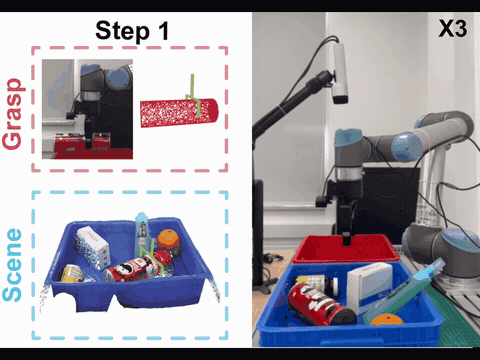
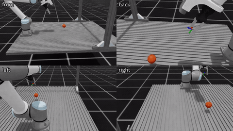
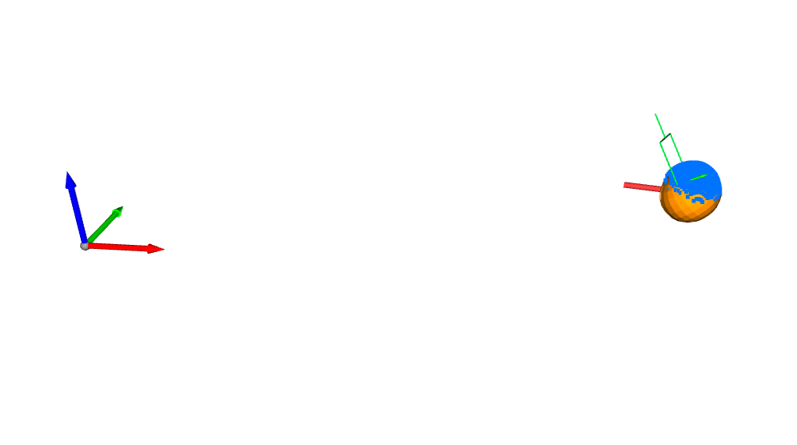
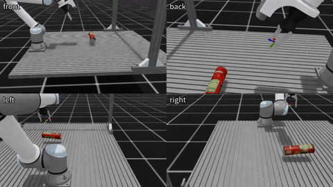
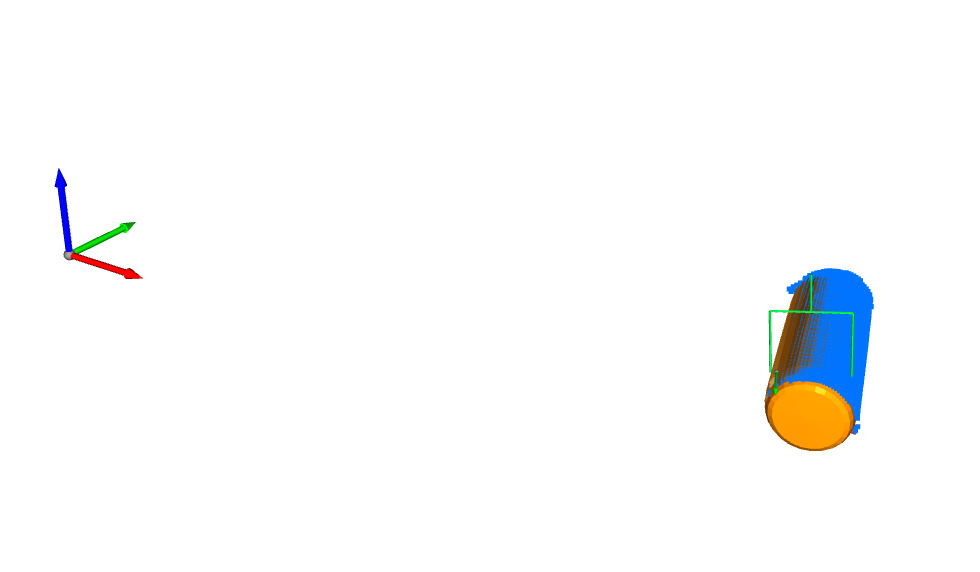
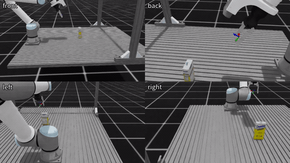
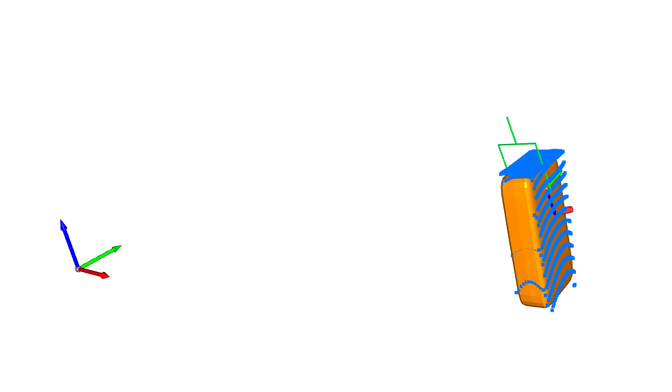
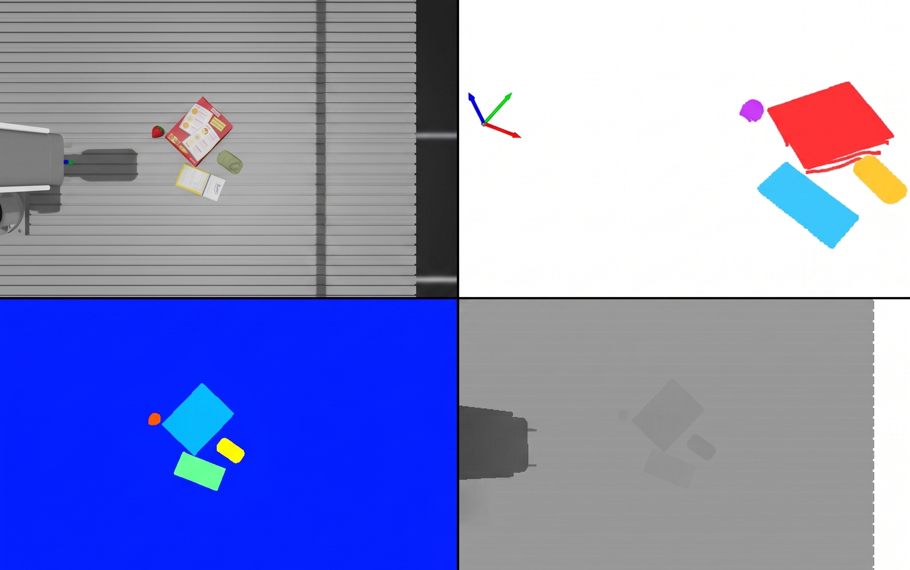

# MetaSQGrasp

**MetaSQGrasp** is a self-contained Isaac Lab framework for robotic bin picking with **superquadric-informed grasping**. It combines physics simulation, synthetic data collection, superquadrics (SQ) / extended superquadrics (ExtSQ) shape estimation, and UR10e pick-and-lift execution in a single pipeline.

The project builds on object assets and grasp-label conventions from [MetaGraspNet](https://github.com/maximiliangilles/MetaGraspNet). Object meshes can be downloaded from the [MetaGraspNet IFL Google Drive folder](https://drive.google.com/drive/folders/1U7pqp0JVDFzGKmypEwJcGf--OJJ-5Xml?usp=sharing) and placed at [`models_ifl/`](models_ifl/) — see [`models_ifl/README.md`](models_ifl/README.md).

---

## Teasers

All teaser media lives in [`metagrasp/MetaSQGrasp/assets/`](metagrasp/MetaSQGrasp/assets/).

**Real-robot demo** — [RGBSQGrasp](https://arxiv.org/abs/2503.02387) bin picking on a UR arm. The left side shows the inferred grasp and the superquadric scene fit; the right side is the robot picking from a single RGB view. This is the real-world experiment from our IROS 2025 Robotic Grasping and Manipulation Competition Workshop paper (Best Workshop Paper).

<p align="center" id="real-robot-demo">
  <a href="#real-robot-demo">
    
  </a>
</p>

Each simulation demo below pairs **Isaac Sim pick-and-lift** (GIF) with **SQ fit and grasp-pose visualization** (PNG) from the same `supersq_grasp-v0` run.

| Demo | Task | Object | Simulation (GIF) | SQ fit & grasp poses (PNG) |
|------|------|--------|------------------|----------------------------|
| 1 | `supersq_grasp-v0` | **016** | [`demo_1.gif`](metagrasp/MetaSQGrasp/assets/demo_1.gif) | [`demo_1.png`](metagrasp/MetaSQGrasp/assets/demo_1.png) |
| 2 | `supersq_grasp-v0` | **010** | [`demo_2.gif`](metagrasp/MetaSQGrasp/assets/demo_2.gif) | [`demo_2.png`](metagrasp/MetaSQGrasp/assets/demo_2.png) |
| 3 | `supersq_grasp-v0` | **001** | [`demo_3.gif`](metagrasp/MetaSQGrasp/assets/demo_3.gif) | [`demo_3.png`](metagrasp/MetaSQGrasp/assets/demo_3.png) |

**Demo 1** — `supersq_grasp-v0`, object **016**

| Isaac Sim execution | SQ estimation & grasp poses |
|:---:|:---:|
|  |  |

**Demo 2** — `supersq_grasp-v0`, object **010**

| Isaac Sim execution | SQ estimation & grasp poses |
|:---:|:---:|
|  |  |

**Demo 3** — `supersq_grasp-v0`, object **001**

| Isaac Sim execution | SQ estimation & grasp poses |
|:---:|:---:|
|  |  |

**Data collection** — `SQ-v0-Data` → [`datasets/supersq_grasp_data/multi_obj_full`](metagrasp/MetaSQGrasp/datasets/supersq_grasp_data/multi_obj_full)

<p align="center">
  
</p>

---

## Tasks

All tasks are launched via [`metagrasp/MetaSQGrasp/run.py`](metagrasp/MetaSQGrasp/run.py) from the MetaSQGrasp project root.

| Task ID | Type | Description | Guide |
|---------|------|-------------|-------|
| `object-v0-Classical` | Classical grasping | UR10e + Robotiq Hand-E; offline HDF5 grasps on the true mesh | [`isaac_env/object_env_classical/README.md`](metagrasp/MetaSQGrasp/isaac_env/object_env_classical/README.md) |
| `object-v1-Classical-2f85` | Classical grasping | Same pipeline with Robotiq 2F85 gripper | [`grasp_sampler/sampling.md`](metagrasp/MetaSQGrasp/grasp_sampler/sampling.md) |
| `SQ-v0-Data` | Data collection | Dual-camera synthetic scenes for SQ training | [`isaac_env/supersq_grasp_data/README.md`](metagrasp/MetaSQGrasp/isaac_env/supersq_grasp_data/README.md) |
| `supersq_grasp-v0` | SQ-based grasping | Live partial PC → SQ/ExtSQ fit → online grasp → pick-lift | [`isaac_env/supersq_grasp_env/README.md`](metagrasp/MetaSQGrasp/isaac_env/supersq_grasp_env/README.md) |

---

## TODOs

| # | Item | Status |
|---|------|--------|
| 1 | Standard UR robotic grasping environment | ✅ Done |
| 2 | Isaac Sim scene-level synthetic dataset generation pipeline | ✅ Done |
| 3 | Superquadrics estimation training/evaluation version 1 | ✅ Done |
| 4 | Extended superquadrics estimation training/evaluation version 1 | ✅ Done |
| 5 | SQ-based robotic grasping for UR manipulator | ✅ Done |
| 6 | ExtSQ-based robotic grasping for UR manipulator | ✅ Done |
| 7 | Standard grasping + SQ-based grasping support for SO-101 manipulator | ⬜ Planned |
| 8 | Superquadrics-informed RL policy learning for UR manipulator | ⬜ Planned |

**Completed items map to:**

| Item | Component |
|------|-----------|
| (1) | `object-v0-Classical`, `object-v1-Classical-2f85` — UR10e + Hand-E / 2F85 pick-and-lift with offline HDF5 grasps |
| (2) | `SQ-v0-Data` — dual-camera scene export under `datasets/supersq_grasp_data/` |
| (3) | `sq_estimation_model/training/` — `sq_esti_model`, `sq_esti_loss`, primitive/object datasets |
| (4) | `extsq_esti_model`, `extsq_esti_loss`, `extsq_est_dataset`, `evaluate_extsq_est_model.py` |
| (5) | `supersq_grasp-v0` with `--sq_model sq_esti_model` |
| (6) | `supersq_grasp-v0` with `--sq_model extsq_esti_model` |
| (7) | `supersq_RL_PPO_grasp-v0` with `--sq_model sq_esti_model` |
---

## Repository layout

```text
MetaSQGrasp_public/
├── README.md
├── IsaacLab/                  # clone NVIDIA Isaac Lab here (gitignored; see Install)
├── models_ifl/                # MetaGraspNet IFL meshes (gitignored; Google Drive)
├── depth-pro/                 # monocular depth estimation
├── SAM/                       # instance segmentation (Segment Anything)
└── metagrasp/MetaSQGrasp/     # main project code
    ├── run.py                 # entry point for all Isaac tasks
    ├── install.md             # conda envs, Isaac stack, pip deps
    ├── workflow.md            # end-to-end project guide
    ├── requirements.txt
    ├── UR_grasp_database/     # curated sim objects + HDF5 + USD (+ workflow.md)
    ├── grasp_sampler/         # antipodal sampling (+ sampling.md, …)
    ├── sq_estimation_model/   # SQ/ExtSQ training + pretrained configs
    ├── isaac_env/             # task environments (+ workflow.md per task)
    ├── tools/                 # asset setup, converters (+ partial-pc-extraction.md)
    ├── datasets/              # runtime-collected sim data
    └── assets/                # README teasers (PNG + GIF)
```

| External folder | Purpose |
|-----------------|---------|
| [`IsaacLab/`](IsaacLab/) | NVIDIA [Isaac Lab](https://github.com/isaac-sim/IsaacLab) installation (Isaac Sim 5.1 + Lab 0.47.2 verified) |
| [`models_ifl/`](models_ifl/) | Full MetaGraspNet IFL object corpus (~20 GB+); not tracked in git |
| `depth-pro/`  | Monocular depth estimation module |
| `SAM/`  | Segmentation module for real-world perception |

---

## Downloadable assets

| Asset | In git? | User action |
|-------|---------|-------------|
| **Full IFL corpus** (`models_ifl/`) | No (README only) | Download from [Google Drive](https://drive.google.com/drive/folders/1U7pqp0JVDFzGKmypEwJcGf--OJJ-5Xml?usp=sharing) → unzip to `MetaSQGrasp_public/models_ifl/` |
| **Curated sim objects** (`UR_grasp_database/`) | Yes (6 IDs) | Use as-is; to add objects: download from `models_ifl/` then run [`UR_grasp_database/workflow.md`](metagrasp/MetaSQGrasp/UR_grasp_database/workflow.md) Steps 0–3 |
| **SQ checkpoints** | Yes (`pretrained/*.pkl`) | Use as-is for `supersq_grasp-v0` |
| **Example dataset** | Yes (`multi_obj_full`) | Use as-is; collect more via `SQ-v0-Data` |
| **Example logs** | Yes (whitelisted paths) | Reproduce via commands in [`logs/README.md`](metagrasp/MetaSQGrasp/logs/README.md) |

```text
MetaSQGrasp_public/
├── models_ifl/              ← download from Google Drive (NOT in git)
└── metagrasp/MetaSQGrasp/
    ├── UR_grasp_database/    ← included in git (smoke-test subset)
    ├── datasets/supersq_grasp_data/multi_obj_full/  ← demo episode in git
    ├── sq_estimation_model/pretrained/*.pkl           ← checkpoints in git
    └── logs/                  ← mostly empty; demo files whitelisted
```

---

## Quick install

Full version matrix and troubleshooting: [`metagrasp/MetaSQGrasp/install.md`](metagrasp/MetaSQGrasp/install.md).

**Two conda environments:** `metagrasp` (Isaac Sim / grasp tasks) and `rgbsq_grasp` (SQ training). Do not mix them in one command.

### 1. Simulation (`metagrasp`)

```bash
conda create -n metagrasp python=3.11 -y
conda activate metagrasp

# Clone Isaac Lab into ./IsaacLab at the repo root, then:
cd IsaacLab
./isaaclab.sh -i
./isaaclab.sh --conda metagrasp

cd ../metagrasp/MetaSQGrasp
pip install -r requirements.txt
```

Verify:

```bash
python -c "import isaaclab; from isaaclab.app import AppLauncher; print('ok')"
```

### 2. Object assets

Download IFL meshes to `models_ifl/` (see [`models_ifl/README.md`](models_ifl/README.md)), then symlink:

```bash
cd metagrasp/MetaSQGrasp/models
ln -sfn ../../../models_ifl models_ifl
```

Seed curated objects and generate grasps — see [`UR_grasp_database/README.md`](metagrasp/MetaSQGrasp/UR_grasp_database/README.md).

### 3. SQ training (`rgbsq_grasp`)

The training env is named `rgbsq_grasp` for historical compatibility

```bash
conda create -n rgbsq_grasp python=3.10 -y
conda activate rgbsq_grasp
pip install torch  # install a CUDA-matched wheel (2.7+ recommended)

cd metagrasp/MetaSQGrasp/sq_estimation_model/training
pip install -r requirements.txt
```

---

## Documentation

| Topic | Quick start | Deep dive |
|-------|-------------|-----------|
| Project hub | [`metagrasp/MetaSQGrasp/README.md`](metagrasp/MetaSQGrasp/README.md) | [`metagrasp/MetaSQGrasp/workflow.md`](metagrasp/MetaSQGrasp/workflow.md) |
| Install and versions | — | [`metagrasp/MetaSQGrasp/install.md`](metagrasp/MetaSQGrasp/install.md) |
| Object assets and HDF5 grasps | [`UR_grasp_database/README.md`](metagrasp/MetaSQGrasp/UR_grasp_database/README.md) | [`UR_grasp_database/workflow.md`](metagrasp/MetaSQGrasp/UR_grasp_database/workflow.md) |
| Grasp sampling and frames | [`grasp_sampler/README.md`](metagrasp/MetaSQGrasp/grasp_sampler/README.md) | [`grasp_sampler/sampling.md`](metagrasp/MetaSQGrasp/grasp_sampler/sampling.md) |
| CLI tools | [`tools/README.md`](metagrasp/MetaSQGrasp/tools/README.md) | [`tools/partial-pc-extraction.md`](metagrasp/MetaSQGrasp/tools/partial-pc-extraction.md) |
| Classical sim (Hand-E) | [`isaac_env/object_env_classical/README.md`](metagrasp/MetaSQGrasp/isaac_env/object_env_classical/README.md) | [`grasp_sampler/sampling.md`](metagrasp/MetaSQGrasp/grasp_sampler/sampling.md) |
| Synthetic data collection | [`isaac_env/supersq_grasp_data/README.md`](metagrasp/MetaSQGrasp/isaac_env/supersq_grasp_data/README.md) | [`isaac_env/supersq_grasp_data/multi-object-collection.md`](metagrasp/MetaSQGrasp/isaac_env/supersq_grasp_data/multi-object-collection.md) |
| SQ-based live grasping | [`isaac_env/supersq_grasp_env/README.md`](metagrasp/MetaSQGrasp/isaac_env/supersq_grasp_env/README.md) | [`isaac_env/supersq_grasp_env/workflow.md`](metagrasp/MetaSQGrasp/isaac_env/supersq_grasp_env/workflow.md) |
| SQ model training | [`sq_estimation_model/training/README.md`](metagrasp/MetaSQGrasp/sq_estimation_model/training/README.md) | — |

---

## Citation

If you use this code, please cite our IROS workshop paper:

```bibtex
@misc{xu2025rgbsqgrasp,
  title={RGBSQGrasp: Inferring Local Superquadric Primitives from Single RGB Image for Graspability-Aware Bin Picking},
  author={Yifeng Xu and Fan Zhu and Ye Li and Sebastian Ren and Xiaonan Huang and Yuhao Chen},
  year={2025},
  eprint={2503.02387},
  archivePrefix={arXiv},
  primaryClass={cs.RO},
  url={https://arxiv.org/abs/2503.02387},
  note={Best Workshop Paper, IROS 2025 Robotic Grasping and Manipulation Competition Workshop}
}
```

Paper: [https://arxiv.org/abs/2503.02387](https://arxiv.org/abs/2503.02387)

If you use MetaGraspNet object assets or labels, please also cite:

```bibtex
@ARTICLE{metagraspnetv2,
  author={Gilles, Maximilian and Chen, Yuhao and Zeng, Emily Zhixuan and Wu, Yifan and Furmans, Kai and Wong, Alexander and Rayyes, Rania},
  journal={IEEE Transactions on Automation Science and Engineering},
  title={MetaGraspNetV2: All-in-One Dataset Enabling Fast and Reliable Robotic Bin Picking via Object Relationship Reasoning and Dexterous Grasping},
  year={2023},
  doi={10.1109/TASE.2023.3328964}
}
```

MetaGraspNet code and dataset documentation: [https://github.com/maximiliangilles/MetaGraspNet](https://github.com/maximiliangilles/MetaGraspNet)

---

## License

MetaGraspNet object assets are under **CC BY-NC-SA 3.0** (academic use only). See [`metagrasp/MetaSQGrasp/doc/dependencies/metagraspnet-license.txt`](metagrasp/MetaSQGrasp/doc/dependencies/metagraspnet-license.txt).
