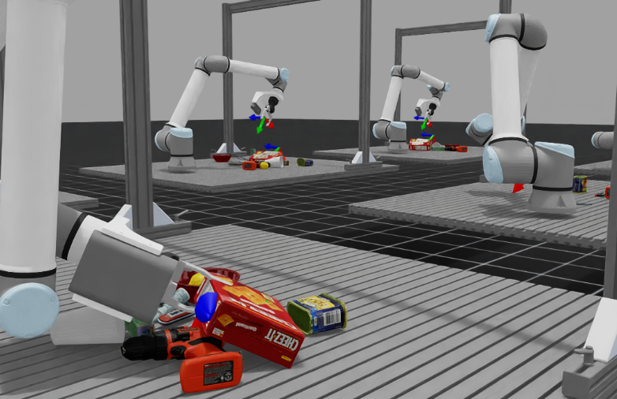
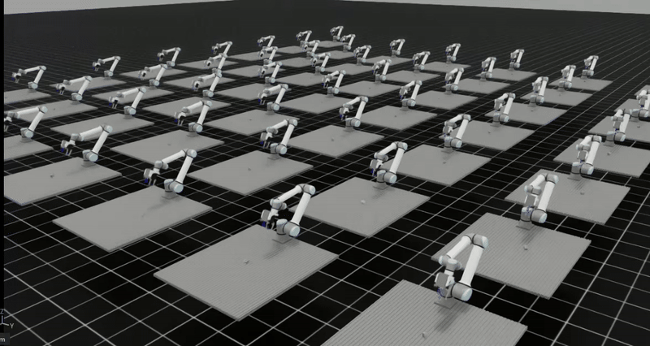
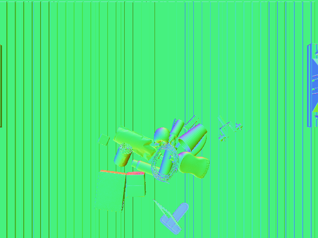

# MetaIsaacGrasp: IsaacLab for Supervised / Reinforcement learning (Support IsaacLab 2.0 and IsaacSim 4.5)

A data generation engine and test bench for grasp learning, powered by [IsaacLab](https://github.com/isaac-sim/IsaacLab) and [MetaGraspNetv2](https://github.com/maximiliangilles/MetaGraspNet) (MGN) including: 

- Data generation `AIR-v0-Data`
- Policy evaluation `AIR-v0-Grasp`
- Teleoperation `AIR-v0-Tele`
- Reinforcement learning `AIR-v0-SB3`, `AIR-v0-SKRL`

### New features:

1. RL support with `stable baseline3` with `AIR-v0-SB3`, `AIR-v0-SKRL`
2. Support IsaacLab 2.0 and IsaacSim 4.5.0
3. Both single-shot grasp execution and continuous learning supported
4. Teleoperation environment `AIR-v0-Tele`
5. Remote grasp agent to work around the environment conflict (see [vMF-Contact](https://github.com/YitianShi/vMF-Contact)))

<div align="center">

<p>Grasp learning data collection and test bench</p>
</div>

<div align="center">
  
  <p style="font-size: 12px;">Reinforcement learning with stable baseline3</p>
</div>

#### Demo video (Inference with remote agent functionality by [vMF-Contact](https://github.com/YitianShi/vMF-Contact))

(*Click to watch, all the successfully grasped objects will be put under the table.)

[](https://www.youtube.com/watch?v=FSXTWSLbo68)

#### Teleoperation

[](https://www.youtube.com/watch?v=XxlxfCCyMCE)

Our teleoperation may also supported by vMF-Contact to reach objects:

[](https://www.youtube.com/watch?v=SV-5fFmEhaA)

<div align="center">
<p float="left">
  
   
  
  
</p>
<p>Captured images: RGB, Segmentation, Depth, Normals</p>
</div>

## Getting started


Make sure you already installed the Isaac-Sim in proper manner.

Install Isaac Lab following the [installation tutourial](https://isaac-sim.github.io/IsaacLab/main/source/setup/installation/pip_installation.html#installing-isaac-sim). Please make sure that is under your home directory: `~/IsaacLab` and following environment variables are added into `.bashrc`:

```
# Isaac Sim python executable
export ISAACSIM_PYTHON_EXE="${ISAACSIM_PATH}/python.sh"
# Add Isaac Lab's sh path for convenience when runing: isaaclab -p *.py
alias isaaclab=/home/{user_name}/IsaacLab/isaaclab.sh
```

## MetaGraspNet objects [available](https://github.com/maximiliangilles/MetaGraspNet/tree/master?tab=readme-ov-file)

Objects are now adapted from [models](https://nx25922.your-storageshare.de/s/9KrFffzwoTmtapR). Keep the full corpus at `/home/sustech/桌面/DSQNet/models_ifl` and seed the curated UR10e + Hand-E test set into `UR_grasp_database/<id>/` with `tools/setup_ur_grasp_database.py`. Run `isaaclab -p urdf_converter.py` to convert URDF files into USD files (!!! Please use isaaclab 1.4 version for urdf conversion since this is now out-of-date for isaaclab 2.0!). We don't use original USD files since all the collision meshes are in convex hull, which are unrealistic.

## SQNet dual-camera data task

`SQ-v0-Data` collects synthetic SQNet scene observations with the AIR setup's UR10e + Hand-E manipulator, object `models_ifl/001`, a fixed on-hand camera, and a second top-down camera above the table. Each stable randomized scene can be saved as raw depth/segmentation/point-cloud data and converted to `rgbsq_grasp` `.npy` samples.

Before the first run, convert the object URDF to a physics-ready USD if `/home/sustech/桌面/DSQNet/models_ifl/001/orbit_obj.usd` is missing:

```bash
cd /home/sustech/桌面/DSQNet/metagrasp/MetaIsaacGrasp
conda activate env_isaaclab
python urdf_converter.py --input /home/sustech/桌面/DSQNet/models_ifl/001/textured.urdf
```

Launch the scene without saving:

```bash
cd /home/sustech/桌面/DSQNet/metagrasp/MetaIsaacGrasp
conda activate env_isaaclab
python run.py --task SQ-v0-Data --num_envs 1 --enable_cameras
```

Collect a bounded dataset:

```bash
cd /home/sustech/桌面/DSQNet/metagrasp/MetaIsaacGrasp
conda activate env_isaaclab
python run.py --task SQ-v0-Data --num_envs 1 --enable_cameras \
  --save_camera_data --output_dir datasets/sqnet_isaac \
  --max_episodes 100 --topdown_height 1.2
```

The top-down camera height is measured in meters above `desk_center`. The camera data uses the same pinhole model as AIR: 640 x 480, `focal_length_cm=1.69`, `horizontal_aperture_mm=2.59`, and modalities `rgb`, `distance_to_image_plane`, `normals`, and `instance_segmentation_fast`. Runtime intrinsics are saved from `camera.data.intrinsic_matrices`.

Dataset layout:

```text
datasets/sqnet_isaac/
  manifest.jsonl
  001/
    epi_000001/
      meta.json
      scene.pt
      camera_onhand/
        rgb.png
        depth.npy
        depth.png
        instance.npy
        instance.png
        normals.npy
        pcd_map.npy
      camera_topdown/
        ...
```

`scene.pt` keeps the AIR-style structure with `camera_0`, `camera_1`, `obj_poses_robot`, and `obj_id`. The sidecar files are easier to inspect from NumPy/OpenCV. `pcd_map.npy` and `camera_pose` are in the robot base frame and meters. `obj_poses_robot` follows the AIR convention with translation in centimeters.

Inspect one saved sample:

```bash
python tools/inspect_sq_sample.py --sample datasets/sqnet_isaac/001/epi_000001 --camera camera_topdown --show_pcd
```

Convert raw samples to `rgbsq_grasp` point-cloud samples:

```bash
python tools/convert_sq_to_npy.py \
  --input datasets/sqnet_isaac/001 \
  --output ../../rgbsq_grasp/datasets/isaac_synth/001 \
  --camera both
```

Each converted `.npy` contains `partial_pc`, `membership`, a coarse box primitive for compatibility, `pcd_frame`, `source_camera`, and `source_sample`. For a quick network-side check, use:

```bash
cd /home/sustech/桌面/DSQNet/rgbsq_grasp
python supersq_inference.py --input datasets/isaac_synth/001/001_0000_viewpoint_00.npy --device cpu
```

## VSCode development

We provide the vscode debugging setup and setting file in ´.vscode´, please replace ´home/yitian´ with your home path.

## Potential Issues

If you cause core dump due to camera setting please run following command:

```
sudo prime-select nvidia
```

in case your 

```
sudo prime-select query
```

returns `on-demand`

## Citation

Please cite our paper which uses the whole framework for reference:

```
@article{shi2024vmf,
  title={vMF-Contact: Uncertainty-aware Evidential Learning for Probabilistic Contact-grasp in Noisy Clutter},
  author={Shi, Yitian and Welte, Edgar and Gilles, Maximilian and Rayyes, Rania},
  journal={arXiv preprint arXiv:2411.03591},
  year={2024}
}
```
