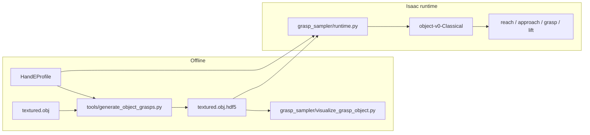

# Classical Antipodal Grasp Sampling (UR10e + Hand-E)

This guide explains how to **generate**, **visualize**, and **execute** antipodal grasp poses for the classical grasp task (`object-v0-Classical`).

For **coordinate frames, pose transformation chain, collision filtering, retry logic, and troubleshooting**, see [classical_grasp_pose_logistics.md](./classical_grasp_pose_logistics.md).

The pipeline targets the current Isaac setup:

| Setting | Value |
|---------|-------|
| Robot | UR10e (`ur10e_hand_e`) |
| Gripper | Robotiq Hand-E |
| EE frame | `hande_end` |
| Max jaw span | 5.0 cm |
| Gripper profile | `hand_e` |

---

## Pipeline overview



**Offline:** sample grasps on the object mesh and store them in HDF5.  
**Online:** load candidates, filter against the live scene, convert to a `hande_end` command, and run the pick state machine.

---

## Prerequisites

- Conda env **`metagrasp`** — grasp generation and visualization
- Conda env **`env_isaaclab`** — Isaac Sim execution
- Object assets under `models_ifl/<id>/`:
  - `textured.obj` — mesh used for sampling
  - `textured.obj.hdf5` — generated grasp database
  - `orbit_obj.usd` — object in simulation (create with `urdf_converter.py`)

---

## 1. Generate grasp poses

Tool: [`tools/generate_object_grasps.py`](../tools/generate_object_grasps.py)

```bash
cd metagrasp/MetaIsaacGrasp
conda activate metagrasp

python tools/generate_object_grasps.py \
  --mesh_root /home/sustech/桌面/DSQNet/models_ifl \
  --categories 001 \
  --gripper_profile hand_e \
  --gripper_length 5.0 \
  --num_points 500 \
  --max_grasps 2000 \
  --pool_size 1
```

### What happens internally

1. Sample contact points on the object surface.
2. Cast rays to find **antipodal** contact pairs.
3. Check **friction cone** constraints at both contacts.
4. Reject pairs wider than **5 cm** (Hand-E limit).
5. Try several approach rotations around the grasp axis.
6. Run **Hand-E collision checks** against the object mesh.
7. Write valid grasps to HDF5.

Core sampler: [`grasp_sampler/generate_grasp_object.py`](../grasp_sampler/generate_grasp_object.py)  
Gripper geometry: [`grasp_sampler/gripper_profiles.py`](../grasp_sampler/gripper_profiles.py) (`HandEProfile`)

### CLI reference

| Flag | Default | Description |
|------|---------|-------------|
| `--mesh_root` | auto-detect | Root folder containing object categories |
| `--categories` | `001` | Object ID(s) to process |
| `--gripper_profile` | `hand_e` | `hand_e` or legacy `franka` |
| `--gripper_length` | profile max width | Max antipodal span in cm |
| `--num_points` | `500` | Surface points to sample |
| `--max_grasps` | `2000` | Max grasps stored per object |
| `--samples_per_point` | `10` | Random approach tries per contact |
| `--pool_size` | `1` | Parallel workers |

Optional: set `HAND_E_USE_STL_COLLISION=1` to use Hand-E STL meshes for collision (slower but more accurate). By default a URDF-dimensioned procedural proxy is used.

---

## 2. Visualize grasps

Script: [`grasp_sampler/visualize_grasp_object.py`](../grasp_sampler/visualize_grasp_object.py)

Opens a Trimesh viewer with the object mesh and sampled grasps (color = quality score, red → green).

```bash
conda activate metagrasp
cd metagrasp/MetaIsaacGrasp

python grasp_sampler/visualize_grasp_object.py \
  --root /home/sustech/桌面/DSQNet \
  --dataset_name models_ifl \
  --object 001 \
  --max_grasps 50 \
  --score_min 0.5
```

### CLI reference

| Flag | Default | Description |
|------|---------|-------------|
| `--root` | — | Parent directory of the dataset |
| `--dataset_name` | `models_ifl` | Dataset folder name |
| `--object` | `047` | Object category ID |
| `--max_grasps` | `24000` | Random subset to display |
| `--score_min` | `0.0` | Lower quality bound |
| `--score_max` | `1.0` | Upper quality bound |

**Note:** The viewer draws a **generic wireframe gripper** for display. The HDF5 data itself is Hand-E-valid (width ≤ 5 cm, Hand-E collision at generation time). Isaac execution uses the real Hand-E geometry and `hande_end` frame.

---

## 3. Execute in Isaac Sim

Convert URDF to USD (once per object):

```bash
conda activate metagrasp
python urdf_converter.py --input /home/sustech/桌面/DSQNet/models_ifl/001/textured.urdf
```

Run the classical smoke task:

```bash
conda activate env_isaaclab
python run.py --task object-v0-Classical --num_envs 1 --enable_cameras
```

### Multi-object runs

`object-v0-Classical` can load a pool of object IDs and randomly select one active object on each episode reset. The active object is spawned at the fixed classical table pose, while inactive objects are moved off the table. Runtime grasp selection uses the active object's ID, so each episode loads grasps from the matching `models_ifl/<id>/textured.obj.hdf5`.

The default pool is `CLASSICAL_OBJ_IDS` in [`isaac_env/object_env_classical/element_cfg.py`](../isaac_env/object_env_classical/element_cfg.py). Override it at runtime with `--obj_ids`:

```bash
conda activate env_isaaclab
python run.py --task object-v0-Classical \
  --obj_ids 001,010,016 \
  --num_envs 1 --headless --enable_cameras \
  --saved_video --saved_video_views front,left,right \
  --max_successful_grasps 3
```

Object IDs are normalized to three digits, so `--obj_ids 1,10,16` resolves to `001,010,016`.

To add a new object ID:

1. Put the object assets under `models_ifl/<id>/`.
2. Generate `textured.obj.hdf5` if it is missing:

```bash
conda activate metagrasp
python tools/generate_object_grasps.py \
  --mesh_root /home/sustech/桌面/DSQNet/models_ifl \
  --categories 010 016 \
  --gripper_profile hand_e \
  --gripper_length 5.0 \
  --num_points 500 \
  --max_grasps 2000 \
  --pool_size 1
```

3. Convert the URDF to the simulation USD expected by the task:

```bash
conda activate metagrasp
python urdf_converter.py --input /home/sustech/桌面/DSQNet/models_ifl/010/textured.urdf --headless
python urdf_converter.py --input /home/sustech/桌面/DSQNet/models_ifl/016/textured.urdf --headless
```

4. Either pass the object with `--obj_ids` or add it to `CLASSICAL_OBJ_IDS`.

Each object in the pool must have:

| File | Purpose |
|------|---------|
| `textured.obj` | Mesh used by the antipodal sampler and runtime collision filter |
| `textured.obj.hdf5` | Generated grasp database |
| `textured.urdf` | Source for USD conversion |
| `orbit_obj.usd` | Isaac simulation asset loaded by `object-v0-Classical` |

### Runtime grasp selection

When the state machine reaches **`choose_object`**, [`isaac_env/object_env_classical/env.py`](../isaac_env/object_env_classical/env.py) calls `grasp_runtime.select_best_grasp(...)` with the live object link pose, table collision filter, ranked retry (`attempt`), and minimum jaw width. See [classical_grasp_pose_logistics.md](./classical_grasp_pose_logistics.md) for the full pipeline.

Steps in [`grasp_sampler/runtime.py`](../grasp_sampler/runtime.py):

1. Load HDF5 grasps for the chosen object.
2. Keep grasps with width ≤ 5 cm and score > 0.
3. Sort by quality; evaluate up to 500 top candidates.
4. Build a scene collision model (table, ground, object at current pose).
5. Keep collision-free grasps for the Hand-E proxy.
6. Rank by **(score, width)**; pick candidate at `rank` (retry index).
7. Convert to a 7D `hande_end` command (position m + quaternion wxyz).

Then the state machine runs **reach → approach → grasp → lift**.

Example log:

```
[Classical Grasp] env=0 episode=0 obj=001 profile=hand_e score=1.000 valid_candidates=500 width_cm=3.81
```

If no collision-free grasp is found, the task falls back to the image-normal demo heuristic.

---

## HDF5 storage format

File: `models_ifl/<id>/textured.obj.hdf5`

```
grasps/
  paralleljaw/
    pregrasp_transform   # (N, 10) float32
    quality_score        # (N,) float32
```

Each row of `pregrasp_transform` is **object-local, in centimeters**:

| Index | Field | Meaning |
|-------|-------|---------|
| 0–2 | `vec_a` | Approach direction |
| 3–5 | `vec_b` | Finger baseline / opening axis |
| 6–8 | `contact_pt` | First antipodal contact point |
| 9 | `width` | Jaw opening (cm) |

Grasps are **not** stored as robot poses. The final `hande_end` pose is computed at runtime from the live object pose in Isaac.

---

## Key files

| File | Role |
|------|------|
| `grasp_sampler/gripper_profiles.py` | Hand-E / Franka geometry and EE conversion |
| `tools/generate_object_grasps.py` | Non-interactive generation CLI |
| `grasp_sampler/generate_grasp_object.py` | Antipodal sampler core |
| `grasp_sampler/runtime.py` | Online scene filter + EE pose |
| `grasp_sampler/visualize_grasp_object.py` | Offline Trimesh viewer |
| `isaac_env/object_env_classical/` | `object-v0-Classical` task |
| `docs/classical_grasp_pose_logistics.md` | Frame conventions, selection, retry, troubleshooting |
| `command.txt` | Copy-paste command snippets |

---

## Related tasks

| Task | Grasp source |
|------|--------------|
| `object-v0-Classical` | HDF5 + Hand-E scene filter (this guide) |
| `AIR-v0-Grasp` | Remote vMF-Contact agent or vision demo |
| `AIR-v0-Data` | Vision demo / optional HDF5 |
