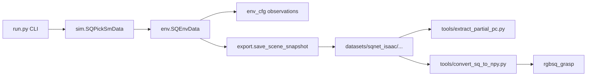

# SQ-v0-Data (`sqnet_env_data`)

Isaac Lab environment package for **SQNet synthetic data collection**. It extends the AIR grasping stack with a dual-camera setup, randomized object poses, and structured dataset export for downstream grasp-pose synthesis (`rgbsq_grasp`).

Registered Gym task: **`SQ-v0-Data`**

---

## Package overview

```
sqnet_env_data/
├── __init__.py      # Gym registration
├── element_cfg.py   # Scene constants, object/camera defaults
├── env_cfg.py       # Scene, observations, events, MDP config
├── env.py           # SQEnvData runtime environment
├── sim.py           # CLI-facing simulation loop wrapper
├── export.py        # Dataset snapshot writer
├── wp_cfg.py        # Warp state-machine kernel re-export
└── README.md        # This file
```

### Data flow



---

## File reference

### `__init__.py`

- Registers the Gym environment `SQ-v0-Data`
- Entry point: `SQEnvData`
- Config entry point: `CellEnvCfg`
- Exports `SQPickSmData`, `SQEnvData`

### `element_cfg.py`

Scene-level constants inherited from `air_env_base.element_cfg`, narrowed for SQNet smoke tests.

| Item | Value / role |
|------|----------------|
| `NUM_OBJS` | `2` |
| `OBJ_LABLE` | `["000", "001"]` |
| `N_MULTIPLE_CAM` | `2` (on-hand + top-down) |
| `MODEL_PATH` | `models/models_ifl` |
| `MGN_PATHS` | USD assets per object ID |
| `SQ_DATA_ROOT` | Default output root: `datasets/sqnet_isaac` |

**Top-down camera tuning** (edit here):

```python
TOPDOWN_CAMERA_XY = (0.75, 0.75)   # world-frame x, y
TOPDOWN_CAMERA_HEIGHT = 1.8          # meters above desk_center[2]
TOPDOWN_CAMERA_QUAT = (0.0, 1.0, 0.0, 0.0)
```

- `make_topdown_camera_cfg(height)` builds a world-fixed `camera_1` prim.
- `TOPDOWN_CAMERA_ROLE_NAMES` maps camera indices to export folder names:
  - `0` → `camera_onhand`
  - `1` → `camera_topdown`

Objects are spawned with `semantic_tags` for instance segmentation.

**Prerequisite:** physics-ready USD at `models/models_ifl/<id>/orbit_obj.usd` for each object. Convert from URDF via:

```bash
python urdf_converter.py --input models/models_ifl/*/textured.urdf
```

### `env_cfg.py`

Defines the full Isaac Lab configuration for SQ data collection.

#### Scene (`CellSceneCfg`)

Reuses AIR robot/table/lighting setup and adds:

- `camera_0` — on-hand camera on the UR10e + Hand-E
- `camera_1` — top-down camera from `make_topdown_camera_cfg()`
- `objs` — single rigid object collection (`obj_0`)
- `ee_frame`, `view_frame` — end-effector / camera frame transformers

#### Observations (`ObservationsCfg`)

Dual-camera capture functions (stacked over `N_MULTIPLE_CAM`):

| Term | Function | Output |
|------|----------|--------|
| `rgb` | `sq_rgb_capture` | RGB image per camera |
| `normals` | `sq_normal_capture` | Surface normals |
| `instance_segmentation_fast` | `sq_inst_capture` | Per-pixel instance IDs |
| `distance_to_image_plane` | `sq_depth_capture` | Depth (clipped to `DEPTH_MAX`) |
| `pcd` | `sq_pcd_capture` | H×W×3 point map in robot base (meters) |
| `gripper_pose` | inherited | Gripper state |

`sq_pcd_capture` back-projects depth with camera intrinsics and pose. Returns a zero map if point cloud size is unexpected (e.g. during init probing).

#### Events (`EventCfg`)

- `reset_robot_pos` — reset arm to default
- `reset_obj_pos` — **`sq_reset_single_random_object`**: each episode places **one random object** on the table and moves the others off-screen; active index stored in `env.obj_chosen`

#### MDP (`CellEnvCfg`)

- Inherits rewards/terminations from AIR base
- Episode length: 5 s, decimation 2, sim dt 1/120

### `env.py` — `SQEnvData`

Runtime environment class extending `AIREnvBase`.

**Constructor kwargs:**

| Arg | Default | Purpose |
|-----|---------|---------|
| `save_camera_data` | `False` | Enable dataset export |
| `output_dir` | `SQ_DATA_ROOT` | Dataset root directory |
| `topdown_height` | `TOPDOWN_CAMERA_HEIGHT` | Top-down camera height override |

**Key behavior:**

1. Maintains dual-camera handles (`camera_0`, `camera_1`).
2. Uses a **data-collection state machine** (`infer_state_machine_data` from `wp_cfg.py`) instead of the grasp-demo machine.
3. On `get_action()` when `save_camera_data=True`:
   - Holds the robot at current EE pose
   - Calls `save_scene_snapshot()` once per `(env_id, episode)`
   - Tracks saved samples via `num_saved_samples`

### `sim.py` — `SQPickSmData`

CLI-facing wrapper used by `run.py`.

**Responsibilities:**

- Parse env config for `SQ-v0-Data`
- Apply `--topdown_height` to `camera_1`
- Pass `--output_dir`, `--save_camera_data`, `--topdown_height` into `gym.make()`
- `propose_action()` — clones full-env `grasp_pose`, updates only inference envs (avoids empty-action crash)
- `should_stop()` — stops when `num_saved_samples >= --max_episodes`

### `export.py`

Writes one episode snapshot when the scene is stable.

#### Per-episode layout

```
<output_dir>/000/epi_000123/
<output_dir>/001/epi_000123/
├── meta.json
├── scene.pt
├── camera_onhand/
│   ├── rgb.png, depth.png, instance.png
│   ├── depth.npy, instance.npy, normals.npy, pcd_map.npy
├── camera_topdown/
│   └── (same structure)
└── partial_pc/
    ├── camera_onhand_auto_instance.npy
    └── camera_topdown_auto_instance.npy
```

#### `save_scene_snapshot(env, env_id, obs_buf, output_dir)`

1. Saves per-camera tensors and preview PNGs
2. Builds `scene.pt` (torch bundle with all camera tensors + object poses)
3. Writes `meta.json` (camera intrinsics, poses, frame conventions, id-to-label maps)
4. Auto-exports object partial point clouds via `tools/sq_partial_pc.py`
5. Appends a row to `<output_dir>/manifest.jsonl`

#### Coordinate frames (`meta.json → frames`)

| Field | Frame |
|-------|-------|
| `camera_pose` | Robot base |
| `pcd_map` | Robot base, meters |
| `obj_poses_robot` | Robot base, translation in **cm** |

### `wp_cfg.py`

Re-exports `infer_state_machine_data` from `air_env_data.wp_cfg` — the Warp GPU kernel that drives the data-collection state machine (reach stable pose → hold → advance episode).

---

## How to run

From `MetaIsaacGrasp/`:

```bash
conda activate metagrasp

python run.py --task SQ-v0-Data --num_envs 1 --enable_cameras \
  --save_camera_data \
  --output_dir datasets/sqnet_isaac \
  --max_episodes 100 \
  --topdown_height 1.8
```

### CLI flags (via `run.py`)

| Flag | Description |
|------|-------------|
| `--save_camera_data` | Enable snapshot export |
| `--output_dir` | Dataset root (default: `datasets/sqnet_isaac`) |
| `--max_episodes` | Stop after N saved samples |
| `--topdown_height` | Override top-down camera Z offset (meters above table) |
| `--enable_cameras` | Required for camera rendering |
| `--num_envs` | Parallel environments (typically `1` for data collection) |

Top-down XY position is configured in `element_cfg.py` (`TOPDOWN_CAMERA_XY`), not via CLI.

---

## Downstream tools

These live outside `sqnet_env_data/` but consume its output:

| Tool | Purpose |
|------|---------|
| `tools/extract_partial_pc.py` | Extract object-only partial point clouds (`--mask`, `--color`) |
| `tools/convert_sq_to_npy.py` | Convert raw samples to `rgbsq_grasp` `.npy` format |
| `tools/inspect_sq_sample.py` | Inspect depth/seg/pcd of one sample |

See also: [`docs/partial_pc_extraction.md`](../../docs/partial_pc_extraction.md)

---

## Design notes

- **Inherits AIR base** — robot, table, on-hand camera, controller, and most MDP terms come from `air_env_base` / `air_env_data`.
- **Multi-object pool** — add IDs to `OBJ_LABLE` / `MGN_PATHS` / `NUM_OBJS` in `element_cfg.py`; one object is sampled per episode.
- **Dual-camera observations** — all image/depth/seg/pcd tensors are shaped `(num_envs, num_cameras, ...)`.
- **Degenerate instance masks** — current single-object data may label the full image as one instance ID; partial PC export uses mesh-bbox fallback (`mask=auto`). Re-collecting with `semantic_tags` should improve segmentation quality.
- **No RL training here** — this package is for synthetic dataset generation, not policy learning.

---

## Quick troubleshooting

| Issue | Check |
|-------|-------|
| `FileNotFoundError` for USD | Run `urdf_converter.py` on object URDF |
| Empty / wrong top-down view | Tune `TOPDOWN_CAMERA_XY` and `TOPDOWN_CAMERA_HEIGHT` in `element_cfg.py` |
| No files saved | Pass `--save_camera_data`; wait until state machine reaches stable snapshot state |
| Collection won't stop | Set `--max_episodes N` |
| Partial PC covers whole scene | Use `tools/extract_partial_pc.py --mask mesh` or `--mask auto` |
