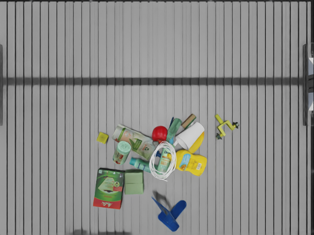
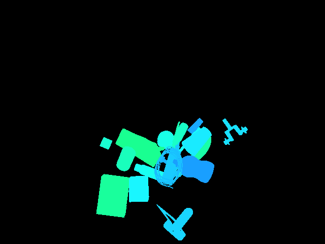
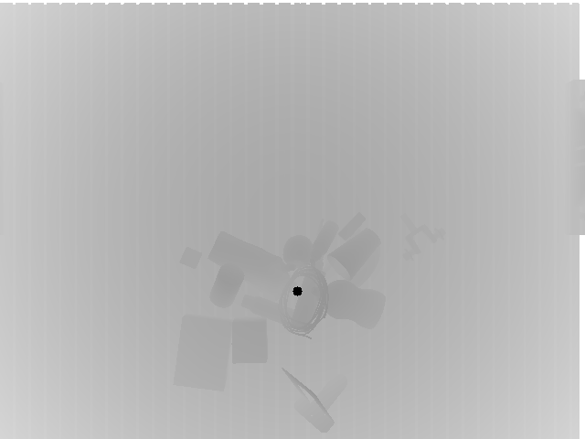

# MetaSQGrasp: IsaacLab for Supervised / Reinforcement learning (Isaac Lab 0.47 + Isaac Sim 5.1 verified)

A data generation engine and test bench for grasp learning, powered by [IsaacLab](https://github.com/isaac-sim/IsaacLab) and [MetaGraspNetv2](https://github.com/maximiliangilles/MetaGraspNet) (MGN) including: 

- Classical antipodal grasp `object-v0-Classical`, `object-v1-Classical-2f85`
- SQ dataset export `SQ-v0-Data`
- SQ-estimated grasp execution `supersq_grasp-v0`

### New features:

1. Isaac Lab **0.47.2** + Isaac Sim **5.1.0** simulation stack (see [docs/environment_versions.md](docs/environment_versions.md))
2. Classical antipodal grasp tasks with Hand-E and Robotiq 2F85 grippers
3. Superquadric dataset generation and SQ-estimated grasp execution

<div align="center">

<p>Grasp learning data collection and test bench</p>
</div>

<div align="center">
  
  <p style="font-size: 12px;">Reinforcement learning with stable baseline3</p>
</div>

#### Demo video (Inference with remote agent functionality by [vMF-Contact](https://github.com/YitianShi/vMF-Contact))

(*Click to watch, all the successfully grasped objects will be put under the table.)

[](https://www.youtube.com/watch?v=FSXTWSLbo68)

#### Teleoperation

[](https://www.youtube.com/watch?v=XxlxfCCyMCE)

Our teleoperation may also supported by vMF-Contact to reach objects:

[](https://www.youtube.com/watch?v=SV-5fFmEhaA)

<div align="center">
<p float="left">
  
   
  
  
</p>
<p>Captured images: RGB, Segmentation, Depth, Normals</p>
</div>

## Getting started

**Workflow overview:** [docs/general_workflow.md](docs/general_workflow.md) — end-to-end guide covering asset setup, data collection, `sq_esti_model` training/evaluation, and SQ-based UR grasping, plus the project roadmap.

**Environment versions:** [docs/environment_versions.md](docs/environment_versions.md) — verified Isaac Lab / Isaac Sim versions, pinned dependencies, and conda setup notes.

Make sure you already installed Isaac Sim and Isaac Lab in the `metagrasp` conda environment.

Install Isaac Lab following the [installation tutorial](https://isaac-sim.github.io/IsaacLab/main/source/setup/installation/pip_installation.html#installing-isaac-sim). Use `~/IsaacLab` as the install root, then wire the conda env:

```bash
cd ~/IsaacLab
conda activate metagrasp
./isaaclab.sh -i
./isaaclab.sh --conda metagrasp
pip install -r /path/to/MetaSQGrasp_public/metagrasp/MetaSQGrasp/requirements.txt
```

Before running `run.py`, verify:

```bash
conda activate metagrasp
export ISAACLAB_PATH=~/IsaacLab
source ~/IsaacLab/_isaac_sim/setup_conda_env.sh
python -c "from isaaclab.app import AppLauncher; print('ok')"
```

Optional `.bashrc` convenience:

```
export ISAACLAB_PATH=~/IsaacLab
alias isaaclab=~/IsaacLab/isaaclab.sh
```

## MetaGraspNet objects [available](https://github.com/maximiliangilles/MetaGraspNet/tree/master?tab=readme-ov-file)

Objects are now adapted from [models](https://nx25922.your-storageshare.de/s/9KrFffzwoTmtapR). Keep the full corpus at `/home/sustech/桌面/MetaSQGrasp_public/models_ifl` and seed the curated UR10e + Hand-E test set into `UR_grasp_database/<id>/` with `tools/setup_ur_grasp_database.py`. Run `python urdf_converter.py --input UR_grasp_database/<id>/textured.urdf --headless` to convert URDF files into USD files. On Isaac Sim 5.1 this converter is less tested than the main sim tasks; see [docs/environment_versions.md](docs/environment_versions.md). We don't use original USD files since all the collision meshes are in convex hull, which are unrealistic.

## Classical antipodal grasp task (`object-v0-Classical`)

UR10e + Robotiq Hand-E pick-and-lift smoke test using offline antipodal grasps from `UR_grasp_database/<id>/textured.obj.hand_e.hdf5`.

| Setting | Value |
|---------|-------|
| Task | `object-v0-Classical` |
| Robot / EE | `ur10e_hand_e` / `hande_end` |
| Max jaw width | **7.0 cm** — edit `grasp_sampler/gripper_profile_defaults.py` |
| HDF5 suffix | `.hand_e` |
| Verified objects | `000`, `001`, `004`, `011` |

**Docs:** [docs/ur_grasp_database_workflow.md](docs/ur_grasp_database_workflow.md) · [docs/classical_grasp_sampling.md](docs/classical_grasp_sampling.md) · [command.txt](command.txt)

Quick start (after seeding assets):

```bash
cd /home/sustech/桌面/MetaSQGrasp_public/metagrasp/MetaSQGrasp
conda activate metagrasp
python tools/generate_object_grasps.py \
  --mesh_root UR_grasp_database --categories 011 --gripper_profile hand_e

conda activate metagrasp
python urdf_converter.py --input UR_grasp_database/011/textured.urdf --headless
python run.py --task object-v0-Classical --obj_ids 011 \
  --num_envs 1 --headless --enable_cameras --saved_video --max_successful_grasps 1
```

Experimental wider-gripper task: `object-v1-Classical-2f85` (Robotiq 2F85, `textured.obj.2f85.hdf5`).

## SQ / extended SQ estimation model training (isolated)

Training for the SQ estimation model (`sq_esti_model`) and ExtSQ estimation model (`extsq_esti_model`) lives in **`sq_estimation_model/training/`**, separate from Isaac sim code. Datasets use JSON manifests with renamed class IDs (`primitive_001` → box, `extsq_est_001` → extended_sq, etc.).

```bash
cd /home/sustech/桌面/MetaSQGrasp_public/metagrasp/MetaSQGrasp/sq_estimation_model/training
conda activate rgbsq_grasp

python train.py --config configs/sq_esti_model_config.yml --device 0 --run sq_esti_model_full
python train.py --config configs/extsq_esti_model_config.yml --device 0 --run extsq_esti_model_full
```

See [sq_estimation_model/training/README.md](sq_estimation_model/training/README.md) for dataset schema, smoke tests, and migration from `rgbsq_grasp/datasets/`.

## SQ estimation grasp task (`supersq_grasp-v0`)

`supersq_grasp-v0` combines the stable Classical UR10e + Hand-E execution stack with live SQ/ExtSQ perception. It uses UR_grasp_database objects, extracts an object-only top-down partial point cloud in memory, estimates a single primitive, samples Hand-E antipodal grasps on the estimated mesh, and executes the normal pick-lift state machine.

**Full workflow:** [docs/supersq_grasp_workflow.md](docs/supersq_grasp_workflow.md)

```bash
cd /home/sustech/桌面/MetaSQGrasp_public/metagrasp/MetaSQGrasp
conda activate metagrasp
python run.py --task supersq_grasp-v0 --obj_ids 004 --num_envs 1 \
  --headless --enable_cameras --saved_video --max_successful_grasps 1
```

For a lightweight smoke test with perception artifacts:

```bash
python -u run.py --task supersq_grasp-v0 --obj_ids 004 --num_envs 1 \
  --headless --enable_cameras --max_successful_grasps 1 \
  --save_sq_debug \
  --sq_model extsq_esti_model \
  --sq_config sq_estimation_model/pretrained/extsq_esti_model/extsq_esti_model_config.yml \
  --sq_checkpoint sq_estimation_model/pretrained/extsq_esti_model/extsq_esti_model_best.pkl
```

Use `--save_sq_debug` to write each attempt under `logs/sq_debug/supersq_grasp-v0/<timestamp>/`. Each attempt folder includes `partial_pc.npy`, `partial_pc.ply`, `sq_mesh_robot.ply`, `grasp_axes.ply`, and `sq_fit.json`, all in the robot-base frame except centimeter-valued grasp matrices recorded in JSON. Visualize one attempt with:

```bash
python tools/inspect_supersq_debug.py \
  --dir logs/sq_debug/supersq_grasp-v0/<timestamp>/env0_epi000001_attempt0_obj004

python tools/inspect_supersq_grasps.py \
  --dir logs/sq_debug/supersq_grasp-v0/<timestamp>/env0_epi000001_attempt0_obj004
```

The Isaac runtime loads estimator code from `sq_estimation_model/training` and expects trained checkpoints under `sq_estimation_model/pretrained/<model>/` unless explicit config/checkpoint paths are passed. Make sure the Isaac Python environment has the estimator runtime packages installed, especially `omegaconf`, `scikit-learn`, `open3d`, and `trimesh`.

## SQ estimation dual-camera data task

`SQ-v0-Data` collects synthetic SQ estimation scene observations with the AIR setup's UR10e + Hand-E manipulator, object `models_ifl/001`, a fixed on-hand camera, and a second top-down camera above the table. Each stable randomized scene can be saved as raw depth/segmentation/point-cloud data and converted to estimator training `.npy` samples.

Before the first run, convert the object URDF to a physics-ready USD if `/home/sustech/桌面/MetaSQGrasp_public/models_ifl/001/orbit_obj.usd` is missing:

```bash
cd /home/sustech/桌面/MetaSQGrasp_public/metagrasp/MetaSQGrasp
conda activate metagrasp
python urdf_converter.py --input /home/sustech/桌面/MetaSQGrasp_public/models_ifl/001/textured.urdf
```

Launch the scene without saving:

```bash
cd /home/sustech/桌面/MetaSQGrasp_public/metagrasp/MetaSQGrasp
conda activate metagrasp
python run.py --task SQ-v0-Data --num_envs 1 --enable_cameras
```

Collect a bounded dataset:

```bash
cd /home/sustech/桌面/MetaSQGrasp_public/metagrasp/MetaSQGrasp
conda activate metagrasp
python run.py --task SQ-v0-Data --num_envs 1 --enable_cameras \
  --save_camera_data --output_dir datasets/supersq_grasp_data \
  --max_episodes 100 --topdown_height 1.2
```

The top-down camera height is measured in meters above `desk_center`. The camera data uses the same pinhole model as AIR: 640 x 480, `focal_length_cm=1.69`, `horizontal_aperture_mm=2.59`, and modalities `rgb`, `distance_to_image_plane`, `normals`, and `instance_segmentation_fast`. Runtime intrinsics are saved from `camera.data.intrinsic_matrices`.

Dataset layout:

```text
datasets/supersq_grasp_data/
  manifest.jsonl
  001/
    epi_000001/
      meta.json
      scene.pt
      camera_onhand/
        rgb.png
        depth.npy
        depth.png
        instance.npy
        instance.png
        normals.npy
        pcd_map.npy
      camera_topdown/
        ...
```

`scene.pt` keeps the AIR-style structure with `camera_0`, `camera_1`, `obj_poses_robot`, and `obj_id`. The sidecar files are easier to inspect from NumPy/OpenCV. `pcd_map.npy` and `camera_pose` are in the robot base frame and meters. `obj_poses_robot` follows the AIR convention with translation in centimeters.

Inspect one saved sample:

```bash
python tools/inspect_sq_sample.py --sample datasets/supersq_grasp_data/001/epi_000001 --camera camera_topdown --show_pcd
```

Convert raw samples to estimator point-cloud samples:

```bash
python tools/convert_sq_to_npy.py \
  --input datasets/supersq_grasp_data/001 \
  --output sq_estimation_model/training/datasets/isaac_synth/001 \
  --camera both
```

Each converted `.npy` contains `partial_pc`, `membership`, a coarse box primitive for compatibility, `pcd_frame`, `source_camera`, and `source_sample`. For a quick network-side check, use:

```bash
cd /home/sustech/桌面/MetaSQGrasp_public/metagrasp/MetaSQGrasp/sq_estimation_model/training
python - <<'PY'
from sq_est_inference import load_sq_model, recognize_sq
from extsq_est_inference import load_sample

points, _, _ = load_sample("datasets/isaac_synth/001/001_0000_viewpoint_00.npy")
model, _ = load_sq_model("configs/sq_esti_model_config.yml", "pretrained/sq_esti_model/sq_esti_model_best.pkl", device="cpu")
print(recognize_sq(points, model, num_fitting_points=300)["parameters"])
PY
```

## VSCode development

We provide the vscode debugging setup and setting file in ´.vscode´, please replace ´home/yitian´ with your home path.

## Potential Issues

If you cause core dump due to camera setting please run following command:

```
sudo prime-select nvidia
```

in case your 

```
sudo prime-select query
```

returns `on-demand`

## Citation

Please cite our paper which uses the whole framework for reference:

```
@article{shi2024vmf,
  title={vMF-Contact: Uncertainty-aware Evidential Learning for Probabilistic Contact-grasp in Noisy Clutter},
  author={Shi, Yitian and Welte, Edgar and Gilles, Maximilian and Rayyes, Rania},
  journal={arXiv preprint arXiv:2411.03591},
  year={2024}
}
```
