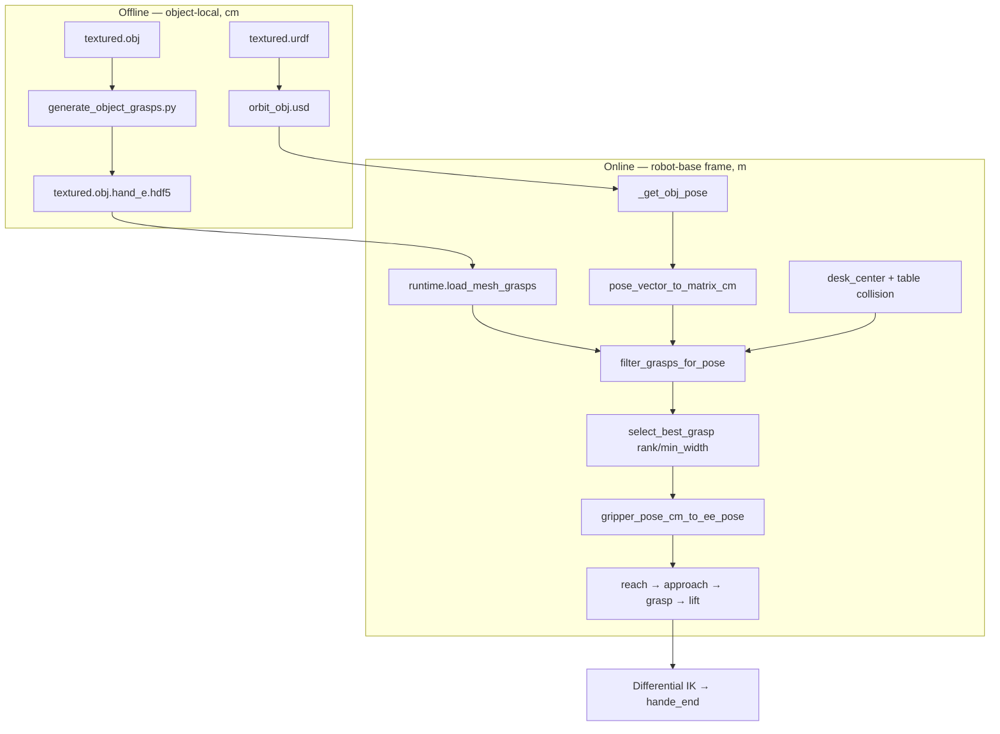

# Classical Grasp Pose Logistics (`object-v0-Classical`)

This document explains **how grasp poses flow through the pipeline** — from offline HDF5 storage to the live `hande_end` command in Isaac Sim — and gives a **step-by-step procedure** for future users.

For generation/visualization CLI details, see [classical_grasp_sampling.md](./classical_grasp_sampling.md).

For the sampler → `hande_end` retargeting chain, verification tools, and axis-mapping reference, see [grasp_retargeting.md](./grasp_retargeting.md).

---

## Quick start

```bash
# 1. Offline preprocessing (once per object)
conda activate metagrasp
cd metagrasp/MetaSQGrasp

python tools/generate_object_grasps.py \
  --mesh_root UR_grasp_database \
  --categories 000 001 004 011 \
  --gripper_profile hand_e \
  --num_points 500 \
  --max_grasps 2000 \
  --pool_size 1

conda activate env_isaaclab
python urdf_converter.py \
  --input UR_grasp_database/011/textured.urdf \
  --headless

# 2. Run in Isaac Sim (--obj_ids overrides CLASSICAL_OBJ_IDS)
python run.py --task object-v0-Classical \
  --obj_ids 011 \
  --num_envs 1 --headless --enable_cameras --saved_video \
  --max_successful_grasps 1
```

---

## System overview



**Key idea:** HDF5 stores grasps in the **object mesh frame** (centimeters). Isaac commands are in the **robot base frame** (meters, `hande_end`). Runtime code bridges the two using the **live object link pose**.

---

## Coordinate frames

| Frame | Units | Used for |
|-------|-------|----------|
| Object-local (HDF5) | cm | Stored antipodal contacts (`vec_a`, `vec_b`, `contact_pt`, `width`) |
| Robot base | m, quat wxyz | `_get_obj_pose`, `_get_ee_pose`, IK command, `grasp_pose` |
| `hande_end` | m, quat wxyz | Differential IK target; state machine reach/approach/grasp/lift |

All runtime grasp math assumes **one consistent frame: robot base** (`ur10e_hand_e/base_link`).

### Object pose source

[`isaac_env/air_env_base/env.py`](../isaac_env/air_env_base/env.py):

```python
_get_obj_pose()  # object_link_pose_w transformed into robot-base frame
```

Uses `object_link_pose_w` (mesh origin), **not** center-of-mass, because HDF5 grasps are defined on the mesh link frame.

### End-effector pose source

```python
_get_ee_pose()  # ee_frame → hande_end relative to base_link
```

This must match the frame of the grasp command sent to the IK controller.

### Table / desk reference

`desk_center` in [`isaac_env/air_env_base/element_cfg.py`](../isaac_env/air_env_base/element_cfg.py) is already in **robot-base frame** (same as object pose). The collision scene in [`grasp_sampler/runtime.py`](../grasp_sampler/runtime.py) places the table top at `desk_center.z`.

Do **not** subtract `robot_root_pos` again when building the collision scene.

---

## Grasp data format (HDF5)

File: `UR_grasp_database/<id>/textured.obj.hand_e.hdf5`

```
grasps/paralleljaw/pregrasp_transform   # (N, 10) float32
grasps/paralleljaw/quality_score        # (N,) float32
```

Each row is **object-local, centimeters**:

| Index | Field | Meaning |
|-------|-------|---------|
| 0–2 | `vec_a` | Approach direction (local +Z of gripper frame) |
| 3–5 | `vec_b` | Finger baseline / jaw opening axis (local +X) |
| 6–8 | `contact_pt` | First antipodal contact point |
| 9 | `width` | Jaw opening (cm) |

Grasps are **not** robot poses. The robot command is computed at runtime.

---

## Pose transformation chain

### Step 1 — Object-local grasp → gripper 4×4 (cm)

[`gripper_profiles.py`](../grasp_sampler/gripper_profiles.py) `HandEProfile.convert_to_gripper_6d()`:

- Builds rotation `[vec_b, cross(vec_a, vec_b), vec_a]`
- Places the command frame at the jaw midpoint, offset by `contact_to_ee_offset_cm` (0 for Hand-E → fingertip frame)

### Step 2 — Compose with live object pose

```python
gripper_pose_cm = object_pose_cm @ convert_to_gripper_6d(vec_a, vec_b, contact_pt, width)
```

`object_pose_cm` is a 4×4 matrix built from `_get_obj_pose()` (m → cm for translation).

### Step 3 — Gripper frame → `hande_end` command

[`gripper_pose_cm_to_ee_pose()`](../grasp_sampler/gripper_profiles.py):

- Sampler approach = gripper local **+Z**
- Loaded Isaac Hand-E USD: jaw baseline maps to EE local **+X**, approach maps to EE local **+Y**
- Legacy Franka profile still uses the old `[baseline, approach, baseline × approach]` remap
- Output: 7D `[x, y, z, qw, qx, qy, qz]` in meters

### Step 4 — State machine uses the command

[`isaac_env/object_env_classical/wp_cfg.py`](../isaac_env/object_env_classical/wp_cfg.py):

| State | EE target |
|-------|-----------|
| `reach` | Pre-grasp: retreat `APPROACH_DISTANCE` along `CLASSICAL_APPROACH_AXIS_EE` (default EE +Y) |
| `approach` | Full `grasp_pose` |
| `grasp` | Hold pose, close gripper |
| `lift` | `grasp_pose` + `LIFT_HEIGHT` in world Z |

---

## Offline preprocessing

### Required assets per object

| File | Purpose |
|------|---------|
| `textured.obj` | Mesh for antipodal sampling |
| `textured.obj.hand_e.hdf5` | Hand-E grasp database (generate; suffix from `gripper_profile_defaults.py`) |
| `textured.urdf` | URDF source |
| `orbit_obj.usd` | Isaac rigid body (convert once) |

Paths resolve from `UR_grasp_database/` under the repo first, then fall back to legacy `models/models_ifl/` or workspace `models_ifl/`.

### Generate grasps

**Always use `--gripper_profile hand_e`** for the UR10e + Hand-E setup. Max jaw width defaults to **7.0 cm** from `grasp_sampler/gripper_profile_defaults.py` (`HAND_E_WIDTH_MAX_CM`). Legacy Franka HDF5 or plain `textured.obj.hdf5` files are not loaded by `object-v0-Classical`.

```bash
python tools/generate_object_grasps.py \
  --mesh_root UR_grasp_database \
  --categories <OBJ_ID> \
  --gripper_profile hand_e \
  --num_points 500 \
  --max_grasps 2000 \
  --pool_size 1
```

### Convert URDF → USD

```bash
python urdf_converter.py \
  --input UR_grasp_database/<OBJ_ID>/textured.urdf \
  --headless
```

Produces `orbit_obj.usd` next to the URDF.

### Optional: visualize offline

```bash
python grasp_sampler/visualize_grasp_object.py \
  --root UR_grasp_database \
  --object <OBJ_ID> \
  --gripper_profile hand_e \
  --frame ee \
  --max_grasps 50
```

---

## Online runtime selection

When the state machine enters **`choose_object`**, [`ObjectEnvClassical.get_action()`](../isaac_env/object_env_classical/env.py) runs:

```python
select_best_grasp(
    obj_id=...,
    object_pose_cm=pose_vector_to_matrix_cm(_get_obj_pose(...)),
    desk_center_m=desk_center,
    profile=hand_e,
    rank=attempt,              # retry index
    min_width_cm=...,          # filter pinching grasps
)
```

### Selection pipeline ([`runtime.py`](../grasp_sampler/runtime.py))

1. Load mesh + HDF5 for the object.
2. Filter: `width > 0`, `width ≤ HAND_E_WIDTH_MAX_CM` (7 cm), `score > 0`.
3. Sort by raw HDF5 quality score; evaluate top `CLASSICAL_MAX_GRASP_CANDIDATES` (default 500).
4. **Collision check** each candidate against:
   - Ground plane
   - Table box at `desk_center`
   - Object mesh at current pose
   - Hand-E procedural gripper (pre-grasp + closed widths)
5. Rank survivors by **raw score + top-down alignment boost**, with jaw width as a tiebreaker.
6. Deduplicate by gripper position (2 cm grid).
7. Return candidate at `rank` (0 = best).

Top-down alignment is computed from the gripper approach axis in the robot-base frame:

```python
approach_dir = gripper_pose_cm[:3, 2]
alignment = dot(normalize(approach_dir), (0.0, 0.0, -1.0))
```

`alignment ≈ 1.0` means the grasp approaches from above, `alignment ≈ 0.0` is a side approach, and negative values indicate bottom-up approaches. This is a **soft** ranking preference: retries still walk through lower-alignment grasps when higher-ranked top-down candidates fail.

### Collision check details

For each candidate, the checker tests:

- Pre-grasp poses at 0 cm and 10 cm retreat along approach
- Closed-gripper width interpolation

Collisions with **table** reject grasps that approach from below the desktop (e.g. “grab upward through the table” on a standing box).

### Fallback

If no collision-free grasp remains at the requested `rank`, the task falls back to the **image-normal demo heuristic** (`get_action_demo`). Watch logs for:

```
[Classical Grasp] No collision-free grasp ... falling back to image-normal demo grasp.
```

---

## Object spawn policy

Episode reset uses a **fixed upright pose** (no random drop, no random orientation):

[`element_cfg.py`](../isaac_env/object_env_classical/element_cfg.py):

```python
CLASSICAL_OBJ_POSE_OFFSET = (0.75, 0.20, 0.08)   # m, relative to default root
CLASSICAL_OBJ_ORIENTATION_WXYZ = (1.0, 0.0, 0.0, 0.0)
```

[`reset_classical_object_pose()`](../isaac_env/object_env_classical/env_cfg.py) runs on episode reset with **zero initial velocity**.

**After a failed lift:** the object is **not** teleported back. The robot waits for stability, reads the **current** object pose, and selects the next ranked grasp. This avoids re-grasping a stale initial pose while the object has moved.

---

## Retry policy

| Event | Behavior |
|-------|----------|
| First grasp in episode | `rank=0`, best collision-free grasp |
| Lift fails → state `init` | `successive_grasp_failure` increments |
| Next `choose_object` | `rank=attempt`, next deduplicated candidate |
| No more candidates | Demo fallback (camera normal heuristic) |
| Full episode reset (`init_env`) | Counter resets; object respawned upright |

Example log:

```
[Classical Grasp] env=0 episode=0 attempt=0 obj=001 profile=hand_e score=1.000 align=0.92 valid_candidates=143 width_cm=4.23 ee_pos=[0.75, 0.17, 0.06]
[Classical Grasp] env=0 episode=0 attempt=1 obj=001 profile=hand_e score=1.000 align=0.88 valid_candidates=143 width_cm=4.21 ee_pos=[0.75, 0.18, 0.08]
```

---

## Configuration reference

Edit [`isaac_env/object_env_classical/element_cfg.py`](../isaac_env/object_env_classical/element_cfg.py):

| Variable | Default | Purpose |
|----------|---------|---------|
| `CLASSICAL_OBJ_IDS` | `["001"]` | Default object pool to load |
| `--obj_ids` | unset | Runtime override for the object pool, for example `001,010,016` |
| `NUM_OBJS` | derived | Number of objects in the configured pool |
| `CLASSICAL_MIN_GRASP_WIDTH_CM` | `1.0` | Reject pinching contacts (important for cylinders like soup cans) |
| `CLASSICAL_MAX_GRASP_CANDIDATES` | `500` | Max HDF5 candidates to collision-check per selection |
| `CLASSICAL_PREFER_TOPDOWN` | `True` | Soft-rank collision-free grasps toward top-down approaches |
| `CLASSICAL_TOPDOWN_WEIGHT` | `0.5` | Alignment boost added to the raw HDF5 score |
| `CLASSICAL_MIN_TOPDOWN_ALIGNMENT` | `0.75` | Prefer candidates at least this top-down; horizontal approaches are 0.0 |
| `CLASSICAL_TOPDOWN_AXIS` | `(0, 0, -1)` | Robot-base down direction used for top-down alignment |
| `APPROACH_DISTANCE` | `0.08` | Classical pre-grasp retreat distance along Hand-E EE +Y |
| `CLASSICAL_PREGRASP_HOLD_TIME` | `0.25` | Pause at pre-grasp before moving toward contact |
| `CLASSICAL_APPROACH_DURATION` | `1.25` | Time to interpolate from pre-grasp to grasp |
| `CLASSICAL_APPROACH_TIMEOUT` | `2.0` | Maximum time allowed in approach before closing |
| `CLASSICAL_OBJ_POSE_OFFSET` | `(0.75, 0.20, 0.08)` | Fixed spawn offset on table |
| `CLASSICAL_OBJ_ORIENTATION_WXYZ` | `(1, 0, 0, 0)` | Upright spawn orientation |

Robot / scene constants live in [`isaac_env/air_env_base/element_cfg.py`](../isaac_env/air_env_base/element_cfg.py):

| Variable | Typical value | Purpose |
|----------|---------------|---------|
| `ROBOT_NAME` | `ur10e_hand_e` | Articulation |
| `ee_name` | `hande_end` | IK command frame |
| `desk_center` | `(0.75, 0.2, 0.0)` | Table center in robot-base frame |
| `APPROACH_DISTANCE` | `0.05` m | Pre-grasp retreat |
| `LIFT_HEIGHT` | `0.4` m | Lift target offset |

---

## Success Video Recording

Use `--saved_video` to record a full-episode MP4 from the Isaac Lab viewer camera and keep it only when the grasp lift succeeds:

```bash
python run.py --task object-v0-Classical --num_envs 1 \
  --headless --enable_cameras --saved_video
```

Notes:

- Isaac Sim still runs; `--headless` only hides the GUI.
- `--enable_cameras` is required for headless off-screen rendering.
- Successful clips are written under `logs/videos/object-v0-Classical/<timestamp>/` unless `--saved_video_dir` is provided.
- Videos are saved directly as **H.264 (`avc1`, yuv420p)** via `ffmpeg` for broad player compatibility.
- Failed episodes discard their temporary MP4, so no file is produced.
- Tune the third-person view with `viewer.eye` and `viewer.lookat` in [`isaac_env/object_env_classical/env_cfg.py`](../isaac_env/object_env_classical/env_cfg.py).

Optional flags:

```bash
python run.py --task object-v0-Classical --num_envs 1 \
  --headless --enable_cameras --saved_video \
  --saved_video_dir logs/videos/classical_demo \
  --saved_video_fps 30 \
  --max_successful_grasps 5
```

Stop limits:

| Flag | Stops when |
|------|------------|
| `--max_successful_grasps N` | `N` successful grasp videos have been saved |
| `--max_episodes N` | `N` full episode resets (`init_env`) have occurred |

---

## Troubleshooting

| Symptom | Likely cause | Fix |
|---------|--------------|-----|
| Robot reaches far from object | Grasp command frame ≠ EE frame; or world coords used as robot-base | Verify `_get_obj_pose` uses link frame + `subtract_frame_transforms` |
| Gripper grasps through table / from below | Table collision frame wrong | `desk_center` is robot-base; do not subtract robot root again in collision scene |
| `[Classical Grasp]` never prints | State machine not reaching `choose_object` yet | Wait for `start` → stable object → first loop iteration |
| `valid_candidates=0` | Missing `textured.obj.hand_e.hdf5` or object too wide | Regenerate with `--gripper_profile hand_e`; check `HAND_E_WIDTH_MAX_CM` |
| Touch but no lift (cylinder) | Pinch grasps (width ≈ 0.1 cm) ranked highest | Increase `CLASSICAL_MIN_GRASP_WIDTH_CM` (e.g. 1.0–1.5) |
| Same grasp on every retry | Was caused by per-episode cache (removed) | Update to latest code; check `attempt=` increments in logs |
| Wrong grasp after object moved | Object reset to initial pose on failure (removed) | Update to latest code; retries use live pose |
| Sugar box / standing object grabbed from below | Table collision not applied | Regenerate runtime with corrected `build_scene_collision_manager` |

---

## Key source files

| File | Role |
|------|------|
| `grasp_sampler/gripper_profile_defaults.py` | Hand-E width (7 cm) and HDF5 suffix |
| `tools/generate_object_grasps.py` | Offline HDF5 generation CLI |
| `grasp_sampler/generate_grasp_object.py` | Antipodal sampler core |
| `grasp_sampler/gripper_profiles.py` | Hand-E geometry, contact → EE conversion |
| `grasp_sampler/runtime.py` | Load HDF5, scene collision filter, ranked selection |
| `isaac_env/classical_shared/` | Shared env cfg factory, sim base, scene config |
| `isaac_env/gripper_task_configs/hand_e.py` | Hand-E task constants |
| `isaac_env/object_env_classical/env.py` | Runtime grasp selection hook |
| `isaac_env/object_env_classical/env_cfg.py` | Fixed object reset, scene/events |
| `isaac_env/object_env_classical/element_cfg.py` | Object ID, spawn pose, tuning constants |
| `isaac_env/object_env_classical/wp_cfg.py` | Pick state machine (reach/approach/grasp/lift) |
| `isaac_env/air_env_base/env.py` | `_get_obj_pose`, `_get_ee_pose`, IK step |

---

## Related tasks

| Task | Grasp source |
|------|--------------|
| `object-v0-Classical` | HDF5 + Hand-E scene filter (this document) |
| `AIR-v0-Grasp` | Remote agent or vision demo |
| `AIR-v0-Data` | Vision demo / optional HDF5 |
