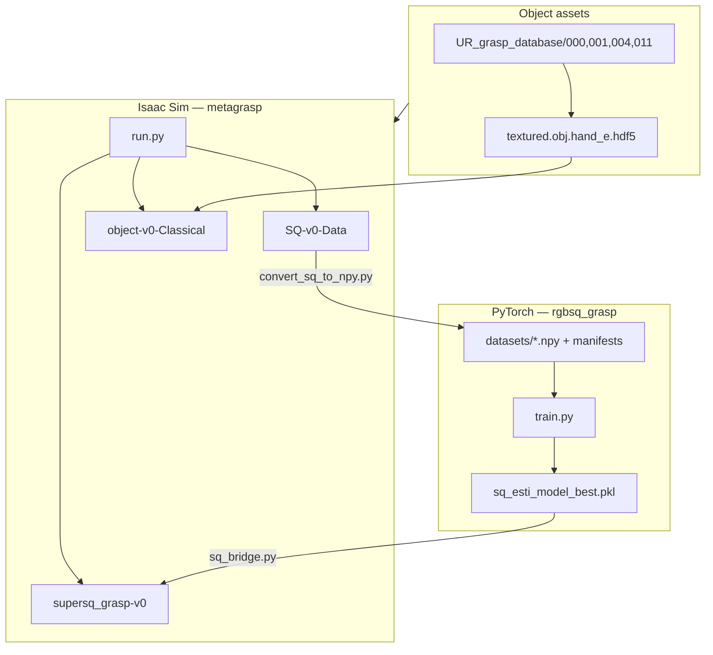

# MetaSQGrasp General Workflow

This document summarizes how the **Isaac Lab simulation stack**, **dataset pipeline**, **SQ estimation training/evaluation**, and **robotic grasping tasks** fit together in MetaSQGrasp.

For task-specific details, see also:

- [environment_versions.md](./environment_versions.md) — verified Isaac Lab / Isaac Sim versions and pinned dependencies
- [ur_grasp_database_workflow.md](./ur_grasp_database_workflow.md) — object assets and HDF5 grasp generation
- [classical_grasp_sampling.md](./classical_grasp_sampling.md) — `object-v0-Classical` baseline
- [supersq_grasp_workflow.md](./supersq_grasp_workflow.md) — live SQ perception + grasp execution
- [partial_pc_extraction.md](./partial_pc_extraction.md) — partial point cloud from saved episodes
- [multi_object_data_collection.md](./multi_object_data_collection.md) — cluttered-scene data export
- [sq_estimation_model/training/README.md](../sq_estimation_model/training/README.md) — training configs and dataset schema

---

## Roadmap / TODO

| # | Item | Status |
|---|------|--------|
| 1 | Standard UR robotic grasping environment | ✅ Done |
| 2 | Isaac Sim scene-level synthetic dataset generation pipeline | ✅ Done |
| 3 | Superquadrics estimation training/evaluation version 1 | ✅ Done |
| 4 | Extended superquadrics estimation training/evaluation version 1 | ✅ Done |
| 5 | SQ-based robotic grasping for UR manipulator | ✅ Done |
| 6 | ExtSQ-based robotic grasping for UR manipulator | ✅ Done |
| 7 | Standard grasping + SQ-based grasping support for SO-101 manipulator | ⬜ Planned |
| 8 | Superquadrics-informed RL policy learning for UR manipulator | ⬜ Planned |

**Completed tasks map to:**

| Task | Component |
|------|-----------|
| (1) | `object-v0-Classical`, `object-v1-Classical-2f85` — UR10e + Hand-E / 2F85 pick-and-lift with offline HDF5 grasps |
| (2) | `SQ-v0-Data` — dual-camera scene export under `datasets/supersq_grasp_data/` |
| (3) | `sq_estimation_model/training/` — `sq_esti_model`, `sq_esti_loss`, primitive/object datasets |
| (4) | `extsq_esti_model`, `extsq_esti_loss`, `extsq_est_dataset`, `evaluate_extsq_est_model.py` |
| (5) | `supersq_grasp-v0` with `--sq_model sq_esti_model` |
| (6) | `supersq_grasp-v0` with `--sq_model extsq_esti_model` |

---

## Architecture Overview

MetaSQGrasp consists of two cooperating stacks:

| Stack | Conda env | Role |
|-------|-----------|------|
| **Isaac Lab simulation** | `metagrasp` | Data collection, classical grasping, SQ-based grasp execution |
| **SQ estimation training** | `rgbsq_grasp` | PyTorch models that fit superquadrics from partial point clouds |

They connect at runtime through `isaac_env/supersq_grasp_env/sq_bridge.py`, which loads checkpoints from `sq_estimation_model/pretrained/` (or custom paths) and calls the same inference code used during training.



### Registered Isaac tasks

| Task ID | Purpose |
|---------|---------|
| `object-v0-Classical` | Oracle antipodal grasping (precomputed HDF5 on true mesh) |
| `object-v1-Classical-2f85` | Same as above with Robotiq 2F85 gripper |
| `SQ-v0-Data` | Dual-camera synthetic data export for SQ training |
| `supersq_grasp-v0` | Live partial PC → SQ fit → online grasp sampling → pick-and-lift |

All tasks are launched via `run.py` from the MetaSQGrasp root directory.

---

## End-to-End Workflows

The examples below use **`sq_esti_model`** as the primary SQ estimator — the stable superquadrics-based model for grasping. Extended superquadrics (`extsq_esti_model`) follow the same pipeline with different config/checkpoint paths.

### Workflow A — Train and deploy SQ estimation for grasping

Recommended path when starting from synthetic primitive data and deploying on the UR manipulator.

```
primitive_dataset (or isaac_synth after conversion)
  → train.py (sq_esti_model)
  → sq_esti_model_best.pkl → sq_estimation_model/pretrained/sq_esti_model/
  → run.py --task supersq_grasp-v0 --sq_model sq_esti_model
  → live grasp execution + optional --save_sq_debug
```

### Workflow B — Sim-to-training data loop

Collect real-sim observations and optionally fine-tune the estimator.

```
run.py --task SQ-v0-Data
  → datasets/supersq_grasp_data/
  → convert_sq_to_npy.py
  → sq_estimation_model/training/datasets/isaac_synth/
  → (optional) add to manifest and retrain sq_esti_model
  → supersq_grasp-v0 evaluation
```

### Workflow C — Classical grasp baseline (no SQ model)

Upper-bound grasp success using oracle mesh grasps.

```
setup_ur_grasp_database → generate_object_grasps → urdf_converter
  → run.py --task object-v0-Classical
```

---

## Step-by-Step Guide

All commands assume the MetaSQGrasp root unless noted:

```bash
cd /path/to/MetaSQGrasp_public/metagrasp/MetaSQGrasp
```

### 0. Prerequisites

**Isaac Sim stack (`metagrasp`):**

- Isaac Lab **0.47.2** + Isaac Sim **5.1.0** (see [environment_versions.md](./environment_versions.md))
- Seed assets into `UR_grasp_database/` via `tools/setup_ur_grasp_database.py`

**Training stack (`rgbsq_grasp`):**

```bash
conda activate rgbsq_grasp
cd sq_estimation_model/training
python -m pip install -r requirements.txt
```

---

### 1. Prepare object assets and classical grasps

Required for `object-v0-Classical` and `supersq_grasp-v0`. See [ur_grasp_database_workflow.md](./ur_grasp_database_workflow.md).

```bash
conda activate metagrasp

python tools/setup_ur_grasp_database.py \
  --source /path/to/models_ifl \
  --objects 000,001,004,011

python tools/generate_object_grasps.py \
  --mesh_root UR_grasp_database \
  --categories 000 001 004 011 \
  --gripper_profile hand_e \
  --num_points 500 \
  --max_grasps 2000

python urdf_converter.py --input UR_grasp_database/000/textured.urdf --headless
# repeat for 001, 004, 011
```

**Smoke test — classical grasping:**

```bash
python run.py --task object-v0-Classical --obj_ids 011 \
  --num_envs 1 --headless --enable_cameras \
  --saved_video --max_successful_grasps 1
```

---

### 2. Collect synthetic scene data (`SQ-v0-Data`)

Exports dual-camera observations (on-hand + top-down) with depth, segmentation, normals, and pre-extracted partial point clouds.

```bash
conda activate metagrasp

python run.py --task SQ-v0-Data --num_envs 1 --enable_cameras --headless \
  --save_camera_data \
  --output_dir datasets/supersq_grasp_data \
  --max_episodes 100 \
  --obj_ids 000,001,004,011
```

**Output layout:**

```text
datasets/supersq_grasp_data/
  manifest.jsonl
  <obj_id>/epi_000000/
    meta.json
    scene.pt              # full export profile
    camera_onhand/        # rgb, depth, instance, normals, pcd_map
    camera_topdown/
    partial_pc/
```

Inspect a sample:

```bash
python tools/inspect_sq_sample.py \
  --sample datasets/supersq_grasp_data/001/epi_000000 \
  --camera camera_topdown
```

Convert to training `.npy` format (optional fine-tuning data):

```bash
python tools/convert_sq_to_npy.py \
  --input datasets/supersq_grasp_data/001 \
  --output sq_estimation_model/training/datasets/isaac_synth/001 \
  --camera both \
  --mask auto
```

---

### 3. Train `sq_esti_model`

Training runs in the isolated package under `sq_estimation_model/training/`, separate from Isaac sim code.

**Default dataset:** `datasets/primitive_dataset/` (6 analytic primitives, JSON manifest splits).

```bash
conda activate rgbsq_grasp
cd sq_estimation_model/training

# Full training (Weights & Biases)
python train.py \
  --config configs/sq_esti_model_config.yml \
  --device 0 \
  --run sq_esti_model_full \
  --wandb-project sq_estimation_model

# Smoke test (CPU, no W&B upload)
WANDB_MODE=disabled python train.py \
  --config configs/sq_esti_model_config_smoke.yml \
  --device cpu \
  --run smoke_sq
```

**Training data flow:**

```
configs/sq_esti_model_config.yml
  → PrimitiveDataset (manifest-driven .npy samples)
      partial_pc (1500 pts) → subsample 300 → diagonal normalize
  → SqEstiModel (DGCNN backbone → 12-dim SQ parameters)
  → sq_esti_loss (geometric fit + orientation prior)
  → RecognitionTrainer (iteration loop, val checkpointing)
  → train_results/sq_esti_model_config/<run>/sq_esti_model_best.pkl
```

**Checkpoint layout:**

```text
train_results/sq_esti_model_config/<run>/
  sq_esti_model_best.pkl
  sq_esti_model_config.yml   # copied config snapshot
```

Copy the best checkpoint to the Isaac runtime default location:

```bash
cp train_results/sq_esti_model_config/sq_esti_model_full/sq_esti_model_best.pkl \
   ../pretrained/sq_esti_model/sq_esti_model_best.pkl
```

---

### 4. Evaluate `sq_esti_model`

Evaluation happens at two levels.

#### 4a. Offline — training validation loop

During training, `RecognitionTrainer` runs validation every `val_interval` iterations, tracks best val loss, and saves `sq_esti_model_best.pkl` (or `extsq_esti_model_best.pkl` for ExtSQ). Optional W&B mesh visualizations compare predicted vs ground-truth superquadrics.

#### 4b. Offline — inference on a single sample

```bash
conda activate rgbsq_grasp
cd sq_estimation_model/training

python - <<'PY'
from sq_est_inference import load_sq_model, recognize_sq, load_sample

sample_path = "datasets/primitive_dataset/primitive_001/primitive_001_0000_viewpoint_01.npy"
points, _, _ = load_sample(sample_path)
model, _ = load_sq_model(
    "configs/sq_esti_model_config.yml",
    "train_results/sq_esti_model_config/sq_esti_model_full/sq_esti_model_best.pkl",
    device="cuda:0",
)
result = recognize_sq(points, model, num_fitting_points=300)
print(result["parameters"])
PY
```

#### 4c. End-to-end — grasp success in simulation

The primary integration test: partial PC → SQ fit → online grasp → UR10e execution.

```bash
conda activate metagrasp
cd /path/to/MetaSQGrasp_public/metagrasp/MetaSQGrasp

python run.py --task supersq_grasp-v0 --obj_ids 004 \
  --num_envs 1 --headless --enable_cameras \
  --saved_video --max_successful_grasps 1 \
  --sq_model sq_esti_model
```

With debug artifacts (partial PC, estimated mesh, grasp axes):

```bash
python run.py --task supersq_grasp-v0 --obj_ids 004 \
  --num_envs 1 --headless --enable_cameras \
  --max_successful_grasps 1 \
  --save_sq_debug \
  --sq_model sq_esti_model \
  --sq_config sq_estimation_model/pretrained/sq_esti_model/sq_esti_model_config.yml \
  --sq_checkpoint sq_estimation_model/pretrained/sq_esti_model/sq_esti_model_best.pkl
```

Visualize debug output:

```bash
python tools/inspect_supersq_debug.py \
  --dir logs/sq_debug/supersq_grasp-v0/<timestamp>/env0_epi000000_attempt0_obj004

python tools/inspect_supersq_grasps.py \
  --dir logs/sq_debug/supersq_grasp-v0/<timestamp>/env0_epi000000_attempt0_obj004
```

Compare against the classical oracle baseline on the same object:

```bash
python run.py --task object-v0-Classical --obj_ids 004 \
  --num_envs 1 --headless --enable_cameras \
  --saved_video --max_successful_grasps 1
```

---

## How Components Connect at Runtime

### Classical grasping (`object-v0-Classical`)

```
run.py → ObjectPickSmClassical
  → select_best_grasp() from UR_grasp_database/<id>/textured.obj.hand_e.hdf5
  → collision filter + top-down ranking
  → Warp pick-lift state machine (reach → approach → grasp → lift)
  → differential IK → UR10e + Hand-E
```

No SQ model involved — grasps are precomputed on the true mesh.

### SQ-based grasping (`supersq_grasp-v0`)

```
run.py → SuperSQPickSm
  → sq_bridge.make_estimator(sq_esti_model)   # loads PyTorch checkpoint
  → extract partial PC from top-down camera
  → fit_superquadric(partial_pc)              # 300-point subsample, same as training
  → select_best_grasp_on_sq_mesh()            # online sampling on estimated SQ mesh
  → same pick-lift state machine as classical
```

The bridge in `isaac_env/supersq_grasp_env/sq_bridge.py` adds `sq_estimation_model/training/` to `sys.path` and imports `sq_est_inference.recognize_sq`, ensuring training and deployment share identical preprocessing and model architecture.

### Data collection (`SQ-v0-Data`)

```
run.py → SQPickSmData
  → wait for stable randomized scene
  → save_scene_snapshot() per episode
  → RGB / depth / segmentation / partial_pc to datasets/supersq_grasp_data/
```

Does not run grasping or SQ inference — pure sensor data export.

---

## Dataset Reference

| Dataset | Location | Used for |
|---------|----------|----------|
| `primitive_dataset` | `sq_estimation_model/training/datasets/primitive_dataset/` | Default `sq_esti_model` training (6 primitives) |
| `object_dataset` | `.../datasets/object_dataset/` | Real-object classes (segmentation-oriented) |
| `evaluation_dataset` | `.../datasets/evaluation_dataset/` | Held-out eval classes |
| `isaac_synth` | `.../datasets/isaac_synth/` | Converted Isaac sim episodes |
| `extsq_est_dataset` | `.../datasets/extsq_est_dataset/` | ExtSQ model training only |
| Raw Isaac export | `datasets/supersq_grasp_data/` | Pre-conversion sim observations |

Each training dataset uses a **`dataset_manifest.json`** with `train` / `validation` / `test` splits. Individual samples are `.npy` dicts with `partial_pc`, `full_pc`, and `primitives` (ground-truth SQ parameters).

---

## Environment Summary

| Task | Conda env | Key packages |
|------|-----------|----------------|
| Isaac sim, data collection, grasp tasks | `metagrasp` | Isaac Lab 0.47.2, Isaac Sim 5.1.0, open3d, trimesh, warp-lang |
| SQ model training | `rgbsq_grasp` | PyTorch 2.7+, omegaconf, scikit-learn |
| SQ inference inside Isaac | `metagrasp` | Same as sim + imports from `sq_estimation_model/training/` |

See [environment_versions.md](./environment_versions.md) for the full version matrix and setup commands.

---

## Quick Command Reference

Copy-paste commands for all workflows are also collected in [command.txt](../command.txt).

```bash
# Classical baseline
python run.py --task object-v0-Classical --obj_ids 011 --num_envs 1 \
  --headless --enable_cameras --saved_video --max_successful_grasps 1

# Data collection
python run.py --task SQ-v0-Data --num_envs 1 --enable_cameras --headless \
  --save_camera_data --output_dir datasets/supersq_grasp_data --max_episodes 100

# Train sq_esti_model
cd sq_estimation_model/training && conda activate rgbsq_grasp
python train.py --config configs/sq_esti_model_config.yml --device 0 --run sq_esti_model_full

# SQ-based grasping (UR manipulator)
conda activate metagrasp
python run.py --task supersq_grasp-v0 --obj_ids 004 --num_envs 1 \
  --headless --enable_cameras --saved_video --max_successful_grasps 1 \
  --sq_model sq_esti_model --save_sq_debug
```
