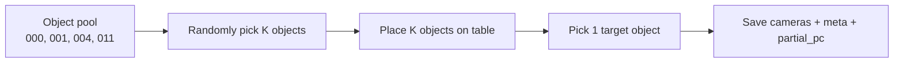

# Multi-Object Scene Data Collection (SQ-v0-Data)

This guide explains how to collect SQ-v0-Data episodes where **multiple objects** appear on the table at once. Use this for occlusion testing, cluttered-scene partial point clouds, and downstream SQ/ExtSQ evaluation on harder views.

Related docs:

- Package reference: [`isaac_env/supersq_grasp_data/README.md`](../isaac_env/supersq_grasp_data/README.md)
- Partial PC extraction: [`partial_pc_extraction.md`](./partial_pc_extraction.md)
- Dataset layout: [`datasets/README.md`](../datasets/README.md)

---

## What changes in a multi-object episode

Each episode still saves **one snapshot**, but the simulator:

1. Loads an **object pool** (`--obj_ids`, default `000,001,004,011`).
2. Randomly places **`--scene_objects` K** distinct objects on the table.
3. Randomly picks **one target** for grasp / labeling (`meta["target_object_id"]`).
4. Moves the remaining pool objects off-screen.



**Important:** episode folders are named after the **target** object:

```text
<output_dir>/<target_object_id>/epi_<episode>/
```

Example: if object `011` is the target, the sample lands in `011/epi_000000/` even when `000`, `001`, and `004` are also on the table.

---

## Prerequisites

From `metagrasp/MetaSQGrasp/`:

```bash
conda activate metagrasp
```

Assets for every ID in your pool must exist under `UR_grasp_database/<id>/`:

- `textured.urdf` / `textured.obj`
- `orbit_obj.usd` (convert once per object)

```bash
python urdf_converter.py --input UR_grasp_database/000/textured.urdf --headless
python urdf_converter.py --input UR_grasp_database/001/textured.urdf --headless
python urdf_converter.py --input UR_grasp_database/004/textured.urdf --headless
python urdf_converter.py --input UR_grasp_database/011/textured.urdf --headless
```

---

## Quick start

### 4 objects on the table (full export, recommended for visualization)

Collect one episode with all demo objects visible. Full export keeps `depth.npy`, `instance.npy`, and `pcd_map.npy` so you can re-extract partial PCs **per object** later.

```bash
cd metagrasp/MetaSQGrasp
conda activate metagrasp

python run.py --task SQ-v0-Data --num_envs 1 --enable_cameras --headless \
  --save_camera_data \
  --export_profile full \
  --obj_ids 000,001,004,011 \
  --scene_objects 4 \
  --output_dir datasets/supersq_grasp_data/multi_obj_full \
  --max_episodes 1 \
  --topdown_height 2.1
```

After collection, inspect RGB / depth / instance PNGs:

```bash
conda activate metagrasp
python tools/inspect_sq_sample.py \
  --sample datasets/supersq_grasp_data/multi_obj_full/011/epi_000000 \
  --camera camera_topdown \
  --show_images
```

Visualize **all scene objects** in one Open3D viewer:

```bash
python tools/visualize_partial_pc.py \
  --sample datasets/supersq_grasp_data/multi_obj_full/011/epi_000000 \
  --source extract --objects all --camera topdown
```

Expected console output (point counts vary per layout):

```text
camera_topdown / 000: 4711 points
camera_topdown / 001: 2047 points
camera_topdown / 004: 762 points
camera_topdown / 011: 217 points
```

### 2 objects on the table (lite export, smaller bundles)

Good for occlusion smoke tests when you only need the **target** partial PC and preview images.

```bash
conda activate metagrasp

python run.py --task SQ-v0-Data --num_envs 1 --enable_cameras --headless \
  --save_camera_data \
  --export_profile lite \
  --obj_ids 000,001,004,011 \
  --scene_objects 2 \
  --output_dir datasets/supersq_grasp_data/multi_obj \
  --max_episodes 20 \
  --topdown_height 2.1
```

Visualize the auto-saved target partial PCs (both cameras):

```bash
conda activate metagrasp
python tools/visualize_partial_pc.py \
  --sample datasets/supersq_grasp_data/multi_obj/000/epi_000009
```

---

## CLI reference

| Flag | Role in multi-object collection |
|------|----------------------------------|
| `--obj_ids` | Object pool loaded into the scene (max count for `--scene_objects`) |
| `--scene_objects` | How many distinct objects are placed on the table per episode |
| `--save_camera_data` | Required to write episode folders |
| `--export_profile full` | Saves all camera tensors + `scene.pt`; enables per-object re-extraction |
| `--export_profile lite` | Smaller bundles (PNGs + `meta.json` + target `partial_pc/`); may also write `.npy` tensors at collection time |
| `--save_scene_pc` | Keep `pcd_map.npy` in lite mode (useful before pruning) |
| `--output_dir` | Dataset root |
| `--max_episodes` | Stop after N saved snapshots |
| `--topdown_height` | Top-down camera height in meters |
| `--enable_cameras` | Required |
| `--headless` | Recommended for batch collection |

Rules:

- `--scene_objects` must be `1 … len(--obj_ids)`.
- Default pool: `000,001,004,011` from `grasp_sampler/database_paths.py`.
- Top-down XY is configured in `isaac_env/supersq_grasp_data/element_cfg.py` (`TOPDOWN_CAMERA_XY`), not via CLI.

---

## Episode layout

### Full profile

```text
datasets/supersq_grasp_data/multi_obj_full/
└── 011/                              # target object id
    └── epi_000000/
        ├── meta.json
        ├── scene.pt
        ├── camera_onhand/
        │   ├── rgb.png, depth.png, instance.png
        │   ├── depth.npy, instance.npy, normals.npy, pcd_map.npy
        ├── camera_topdown/
        │   └── (same structure)
        └── partial_pc/
            ├── camera_onhand_auto_instance.npy    # target object only
            └── camera_topdown_auto_instance.npy
```

### Lite profile

```text
datasets/supersq_grasp_data/multi_obj/
└── 000/
    └── epi_000009/
        ├── meta.json
        ├── camera_onhand/   # rgb.png, depth.png, instance.png
        ├── camera_topdown/
        └── partial_pc/      # target object only, both cameras
```

To shrink a full episode after verification:

```bash
python tools/prune_sq_sample_lite.py \
  --input datasets/supersq_grasp_data/multi_obj_full/011/epi_000000 \
  --output datasets/supersq_grasp_data/multi_obj/011/epi_000000
```

`prune_sq_sample_lite.py` removes `scene.pt`, `depth.npy`, `instance.npy`, `normals.npy`, and (by default) `pcd_map.npy`. After pruning you can no longer run `--source extract` for non-target objects.

---

## `meta.json` fields for multi-object scenes

| Field | Meaning |
|-------|---------|
| `object_id` / `target_object_id` | Grasp / labeling target |
| `scene_objects` | Number of objects on the table (`K`) |
| `scene_object_ids` | All object labels visible in the scene |
| `distractor_ids` | Scene objects that are not the target |
| `obj_poses_robot` | 4×4 poses for every pool object (robot base, translation in cm) |
| `cameras.*.id_to_labels` | Maps instance segmentation IDs → object labels (`000`, `001`, …) |
| `partial_pc` | Auto-exported target partial PCs per camera |

Example snippet:

```json
{
  "object_id": "011",
  "target_object_id": "011",
  "scene_objects": 4,
  "scene_object_ids": ["000", "001", "004", "011"],
  "distractor_ids": ["000", "001", "004"]
}
```

---

## Partial point clouds in multi-object scenes

### What is saved automatically

During export, `partial_pc/` stores the **target object only** (one cloud per camera). Distractor objects are not written to separate files.

### Per-object extraction (all scene objects)

Requires full tensors (`depth.npy` + `pcd_map.npy`). Use `--export_profile full` or an unpruned lite episode that still has `.npy` files.

```bash
# One object
python tools/extract_partial_pc.py \
  --sample datasets/supersq_grasp_data/multi_obj_full/011/epi_000000 \
  --camera topdown --mask instance --color instance --show

# All objects in one viewer (recommended)
python tools/visualize_partial_pc.py \
  --sample datasets/supersq_grasp_data/multi_obj_full/011/epi_000000 \
  --source extract --objects all --camera topdown
```

### Mask mode guidance

| Situation | Use |
|-----------|-----|
| Multi-object scene (`scene_objects > 1`) | `--mask instance` or `--mask auto` |
| Single-object scene | `--mask auto` or `--mask mesh` also OK |

Never use `--mask mesh` on multi-object scenes: distractor points can fall inside the target mesh bounding box.

`mask=auto` skips the mesh-bbox fallback when `scene_objects > 1` and relies on instance segmentation labels from `id_to_labels`.

---

## Suggested collection recipes

| Goal | `--scene_objects` | `--export_profile` | Output dir example |
|------|-------------------|--------------------|--------------------|
| Cluttered table, per-object visualization | `4` | `full` | `multi_obj_full/` |
| Target-only occlusion testing | `2` | `lite` | `multi_obj/` |
| Many episodes per target ID | `2` | `lite` | `multi_obj/` with `--max_episodes 50` |
| Estimator training on target partial PCs | `1` or `2` | `lite` or `full` | then `tools/convert_sq_to_npy.py` |

Batch collection across the pool (each episode randomizes which K objects appear and which one is the target):

```bash
python run.py --task SQ-v0-Data --num_envs 1 --enable_cameras --headless \
  --save_camera_data --export_profile full \
  --obj_ids 000,001,004,011 \
  --scene_objects 4 \
  --output_dir datasets/supersq_grasp_data/multi_obj_full \
  --max_episodes 40 \
  --topdown_height 2.1
```

Episodes will be spread across `000/`, `001/`, `004/`, and `011/` depending on which object was chosen as the target.

---

## Inspection checklist

After one episode is saved:

1. **Images** — `inspect_sq_sample.py --show_images` on `camera_topdown`; confirm multiple instance colors in `instance.png`.
2. **Meta** — open `meta.json`; verify `scene_object_ids` length matches `--scene_objects`.
3. **Target partial PC** — `visualize_partial_pc.py` with default `--source saved`.
4. **All objects** — `visualize_partial_pc.py --source extract --objects all` on a full-export sample.
5. **Manifest** — check `<output_dir>/manifest.jsonl` for one new row per episode.

---

## Troubleshooting

| Issue | Fix |
|-------|-----|
| `FileNotFoundError` for `multi_obj_full/000/epi_000000` | Episodes are stored under the **target** ID folder. List `multi_obj_full/*/epi_*` to find saved samples. |
| `visualize_partial_pc.py --source extract` fails on lite data | Re-collect with `--export_profile full`, or prune only after per-object extraction is done. |
| Instance mask shows only one object | Confirm `--scene_objects > 1` and check `id_to_labels` in `meta.json`. |
| Target partial PC is sparse / has holes | Expected under occlusion; check `visible_target_fraction` in saved `partial_pc` payloads. |
| `mask=mesh is unsafe for multi-object scenes` | Switch to `--mask instance` or `--mask auto`. |
| Collection stops immediately | Pass `--save_camera_data` and a positive `--max_episodes`. |
| No USD for an object ID | Run `urdf_converter.py` for that ID under `UR_grasp_database/`. |

---

## Tool summary

| Tool | Multi-object use |
|------|------------------|
| `tools/visualize_partial_pc.py` | View target (`--source saved`) or all objects (`--source extract --objects all`) |
| `tools/inspect_sq_sample.py` | Print per-object point counts; show RGB/depth/instance |
| `tools/extract_partial_pc.py` | Re-extract one target cloud from full tensors |
| `tools/prune_sq_sample_lite.py` | Shrink full episodes after validation |
| `tools/convert_sq_to_npy.py` | Convert target partial PCs to estimator `.npy` format |
