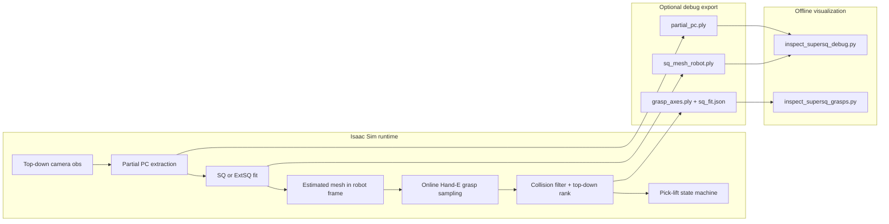

# SuperSQ Grasp Workflow (`supersq_grasp-v0`)

This guide explains the full **perception-to-grasp** pipeline for `supersq_grasp-v0`: live partial point cloud extraction, SQ/ExtSQ fitting, online Hand-E grasp sampling on the estimated mesh, Isaac execution, and offline visualization.

For the classical HDF5-based baseline (`object-v0-Classical`), see [classical_grasp_sampling.md](./classical_grasp_sampling.md).  
For partial point cloud extraction from saved SQ-v0-Data samples, see [partial_pc_extraction.md](./partial_pc_extraction.md).  
For curated object assets, see [ur_grasp_database_workflow.md](./ur_grasp_database_workflow.md).

---

## What this task does

`supersq_grasp-v0` combines:

| Layer | Component |
|-------|-----------|
| Robot / gripper | UR10e + Robotiq Hand-E (`hand_e` profile) |
| Scene | `UR_grasp_database/<id>/` objects |
| Cameras | On-hand `camera_0` + fixed top-down `camera_1` |
| Perception | Live object-only partial PC from top-down view (default) |
| Shape | Single `sq_esti_model` or `extsq_esti_model` primitive per episode |
| Grasp | Online antipodal sampling on estimated SQ/ExtSQ mesh |
| Execution | Classical pick-lift state machine (reach / approach / grasp / lift) |

Unlike `object-v0-Classical`, this task does **not** load precomputed HDF5 grasps at runtime.

---

## Pipeline overview



**Per episode (first grasp attempt):**

1. Reset scene with one object from `--obj_ids`.
2. Capture dual-camera observations (`camera_0`, `camera_1`).
3. Extract object-only partial point cloud from the selected camera (default: top-down).
4. Run the selected SQ estimator once; cache the fit for that episode.
5. Sample antipodal grasps on the SQ or ExtSQ mesh, collision-filter against table/object/gripper.
6. Rank by score + top-down alignment; pick grasp by retry rank.
7. Execute grasp with the Hand-E state machine.
8. Optionally save debug artifacts and/or success videos.

---

## Prerequisites

Full version matrix: [environment_versions.md](./environment_versions.md).

### Conda environments

| Env | Used for |
|-----|----------|
| `metagrasp` | Isaac Sim / Isaac Lab runs, debug/grasp visualization, asset seeding |
| `rgbsq_grasp` | Offline SQ / ExtSQ training only |

### Verified simulation stack (`metagrasp`)

| Component | Version |
|-----------|---------|
| Isaac Sim | **5.1.0.0** (pip); binary `5.1.0-rc.19` under `~/IsaacLab/_isaac_sim` |
| Isaac Lab core | **0.47.2** (editable from `~/IsaacLab/source/isaaclab`) |
| PyTorch | **2.7.0+cu128** |
| NumPy | **1.26.0** (`numpy<2`) |
| Python | **3.11.x** |

Before `run.py`:

```bash
conda activate metagrasp
export ISAACLAB_PATH=~/IsaacLab
source ~/IsaacLab/_isaac_sim/setup_conda_env.sh
python -c "from isaaclab.app import AppLauncher; print('ok')"
```

### Python packages (inside `metagrasp`)

Required for `supersq_grasp-v0`:

- Isaac Lab / Isaac Sim stack (see table above)
- SQ estimation runtime from `sq_estimation_model/training`
- `omegaconf>=2.3.0`, `scikit-learn`, `open3d>=0.19.0`, `trimesh>=4.5.1`, `warp-lang>=1.14.0`

Install MetaSQGrasp extras:

```bash
pip install -r requirements.txt
```

Default SQ estimator checkpoint:

```text
/home/sustech/桌面/MetaSQGrasp_public/metagrasp/MetaSQGrasp/sq_estimation_model/pretrained/sq_esti_model/sq_esti_model_best.pkl
```

Default SQ estimator config:

```text
/home/sustech/桌面/MetaSQGrasp_public/metagrasp/MetaSQGrasp/sq_estimation_model/pretrained/sq_esti_model/sq_esti_model_config.yml
```

### Object assets

Each object ID under `UR_grasp_database/<id>/` must have:

- `orbit_obj.usd` — simulation asset
- `textured.obj` — mesh used for partial-PC mesh-bbox fallback

**Verified smoke-test IDs (2026-06):** `000`, `001`, `004`, `011`.

List local IDs:

```bash
ls /home/sustech/桌面/MetaSQGrasp_public/metagrasp/MetaSQGrasp/UR_grasp_database
```

SuperSQ does **not** require `textured.obj.hand_e.hdf5` at runtime (unlike `object-v0-Classical`).

**Shared demo object pool:** `000`, `001`, `004`, `011` (`DEMO_OBJ_IDS` in `grasp_sampler/database_paths.py`). These IDs are the default for `supersq_grasp-v0`, `object-v0-Classical`, and `SQ-v0-Data`. A lite demo dataset lives under [`datasets/supersq_grasp_data/demo/`](../datasets/supersq_grasp_data/demo/README.md).

---

## 1. Prepare object assets (if needed)

From `metagrasp/MetaSQGrasp`:

```bash
cd /home/sustech/桌面/MetaSQGrasp_public/metagrasp/MetaSQGrasp
conda activate metagrasp

# Copy mesh/URDF from models_ifl into UR_grasp_database
python tools/setup_ur_grasp_database.py \
  --source /home/sustech/桌面/MetaSQGrasp_public/models_ifl \
  --objects 011 \
  --overwrite
```

Convert URDF to USD if `orbit_obj.usd` is missing:

```bash
conda activate metagrasp
python urdf_converter.py --input UR_grasp_database/011/textured.urdf --headless
```

---

## 2. Run experiments

Always start from:

```bash
cd /home/sustech/桌面/MetaSQGrasp_public/metagrasp/MetaSQGrasp
conda activate metagrasp
```

### 2.1 Recommended smoke test (with debug artifacts)

```bash
python -u run.py --task supersq_grasp-v0 --obj_ids 004 --num_envs 1 \
  --headless --enable_cameras --max_successful_grasps 1 \
  --save_sq_debug \
  --sq_model extsq_esti_model \
  --sq_config sq_estimation_model/pretrained/extsq_esti_model/extsq_esti_model_config.yml \
  --sq_checkpoint sq_estimation_model/pretrained/extsq_esti_model/extsq_esti_model_best.pkl
```

At startup, look for:

```text
[INFO] SuperSQ debug output: logs/sq_debug/supersq_grasp-v0/<timestamp>/
[SuperSQ] Camera config N_MULTIPLE_CAM=2 sq_camera=topdown sq_camera_index=1
[SuperSQ] Observation shapes depth=(1, 2, 480, 640, 1) pcd=(1, 2, 480, 640, 3)
```

Expected observation shapes confirm the dual-camera fix is active.

### 2.2 Full run with success videos

```bash
python -u run.py --task supersq_grasp-v0 --obj_ids 004 --num_envs 1 \
  --headless --enable_cameras --saved_video --max_successful_grasps 1 \
  --save_sq_debug
```

Success videos are written under:

```text
logs/videos/supersq_grasp-v0/<timestamp>/
```

### 2.3 Test another object

Replace the object ID:

```bash
python -u run.py --task supersq_grasp-v0 --obj_ids 011 --num_envs 1 \
  --headless --enable_cameras --max_successful_grasps 1 \
  --save_sq_debug
```

### 2.4 Test multiple objects in one run

The environment randomly picks one object from the pool on each episode reset:

```bash
python -u run.py --task supersq_grasp-v0 --obj_ids 000,001,004,011,016 --num_envs 1 \
  --headless --enable_cameras --max_successful_grasps 3 \
  --save_sq_debug
```

### 2.5 Useful CLI flags

| Flag | Default | Description |
|------|---------|-------------|
| `--obj_ids` | task default | Comma-separated IDs, e.g. `004,011` |
| `--num_envs` | `1` | Parallel environments |
| `--headless` | off | Headless Isaac Sim |
| `--enable_cameras` | off | Required for perception |
| `--save_sq_debug` | off | Export perception/grasp debug artifacts |
| `--sq_debug_dir` | auto timestamp dir | Custom debug output root |
| `--sq_camera` | `topdown` | `topdown` (camera_1) or `onhand` (camera_0) |
| `--sq_model` | `sq_esti_model` | `sq_esti_model` or `extsq_esti_model` |
| `--sq_config` | local pretrained YAML | SQ estimator config path |
| `--sq_checkpoint` | local pretrained pkl | SQ estimator weights |
| `--sq_device` | auto | SQ estimator device |
| `--sq_num_fitting_points` | `300` | Points used by SQ estimator preprocessing |
| `--saved_video` | off | Save MP4 on successful grasps |
| `--saved_video_dir` | auto | Custom video output directory |
| `--saved_video_views` | `front,left,right,back` | External camera presets |
| `--max_successful_grasps` | none | Stop after N successful grasps |
| `--max_episodes` | none | Stop after N episode resets |

Task tuning constants live in [`isaac_env/supersq_grasp_env/element_cfg.py`](../isaac_env/supersq_grasp_env/element_cfg.py):

| Constant | Default | Meaning |
|----------|---------|---------|
| `SUPERSQ_MIN_PARTIAL_PC_POINTS` | `50` | Minimum object points before SQ fit |
| `SUPERSQ_MESH_RESOLUTION` | `12` | SQ mesh tessellation |
| `SUPERSQ_NUM_SURFACE_POINTS` | `120` | Surface samples for grasp generation |
| `SUPERSQ_MAX_GRASPS` | `250` | Max antipodal candidates per fit |

---

## 3. Debug output layout

With `--save_sq_debug`, each grasp attempt is saved under:

```text
logs/sq_debug/supersq_grasp-v0/<timestamp>/env{id}_epi{episode}_attempt{n}_obj{id}/
```

Example:

```text
logs/sq_debug/supersq_grasp-v0/2026-06-09_18-43-55/env0_epi000000_attempt0_obj011/
```

List all attempts from one run:

```bash
ls logs/sq_debug/supersq_grasp-v0/<timestamp>/
```

### Files per attempt

| File | Frame | Contents |
|------|-------|----------|
| `partial_pc.npy` | robot base, m | Full extraction payload (points + mask metadata) |
| `partial_pc.ply` | robot base, m | Object-only partial point cloud |
| `sq_mesh_robot.ply` | robot base, m | Fitted superquadric mesh |
| `grasp_axes.ply` | robot base, m | Coordinate frame at selected gripper pose |
| `sq_fit.json` | mixed | Numeric SQ parameters, SE(3), grasp selection |
| `observation/depth.png` | camera view | Normalized depth preview used for partial PC |
| `observation/instance.png` | camera view | Instance segmentation colormap |
| `observation/object_mask.png` | camera view | Final object-only pixel mask |
| `observation/rgb.png` | camera view | RGB frame (if enabled in scene modalities) |
| `observation/preview_montage.png` | camera view | 2×2 preview saved by `inspect_supersq_obs.py` |
| `observation/obs_meta.json` | — | Camera index, role, `id_to_labels` |

### Key fields in `sq_fit.json`

| Field | Description |
|-------|-------------|
| `parameters` | SQ shape parameters (`a1`, `a2`, `a3`, `e1`, `e2`) |
| `se3_m` | Object pose in robot base frame (meters, 4×4) |
| `num_points` | Partial PC point count |
| `mask_method` | How object pixels were selected (`instance_label`, `mesh_bbox`, …) |
| `selection.gripper_pose_cm` | Selected grasp, sampler frame (cm, 4×4) |
| `selection.contact_pose_cm` | Contact frame (cm, 4×4) |
| `selection.width_cm` | Grasp width |
| `selection.approach_alignment` | Top-down alignment score |
| `selection.candidate_count` | Number of collision-free ranked candidates |

Debug is also saved when partial PC extraction succeeds but SQ fit fails (too few points).

---

## 4. Visualization

All visualization commands assume:

```bash
cd /home/sustech/桌面/MetaSQGrasp_public/metagrasp/MetaSQGrasp
conda activate metagrasp
```

### Shorthand path selection

You do not need to build long `env*_epi*_attempt*_obj*` paths manually. All three inspect tools accept:

| Flag | Example | Meaning |
|------|---------|---------|
| `--run` | `--run 2026-06-09_19-01-25` | One timestamp under `logs/sq_debug/supersq_grasp-v0/` |
| `--latest` | `--latest` | Newest run (episode 0 by default) |
| `--episode` | `--episode 2` | Pick `env0_epi000002_...` inside the run |
| `--list-runs` | `--list-runs` | Print available run timestamps |
| `--list-episodes` | `--run 2026-06-09_19-01-25 --list-episodes` | Print attempt folders in a run |
| `--dir` | full path | Still supported for explicit folders |

Quick examples for run `2026-06-09_19-01-25`:

```bash
# List runs / episodes
python tools/inspect_supersq_obs.py --list-runs
python tools/inspect_supersq_obs.py --run 2026-06-09_19-01-25 --list-episodes

# Visualize episode 0
python tools/inspect_supersq_obs.py --run 2026-06-09_19-01-25 --no-show
python tools/inspect_supersq_debug.py --run 2026-06-09_19-01-25
python tools/inspect_supersq_grasps.py --run 2026-06-09_19-01-25

# Latest run, episode 2
python tools/inspect_supersq_debug.py --latest --episode 2

# Save observation montages for all episodes in one run
python tools/inspect_supersq_obs.py --run 2026-06-09_19-01-25 --all-episodes --no-show
```

### 4.1 SQ mesh + partial point cloud

Tool: [`tools/inspect_supersq_debug.py`](../tools/inspect_supersq_debug.py)

```bash
python tools/inspect_supersq_debug.py --run 2026-06-09_19-01-25
```

Shows:

- blue — partial point cloud
- orange — fitted superquadric mesh
- small RGB axes — selected grasp frame (`grasp_axes.ply`)
- world frame at origin

### 4.2 Grasp pose (Hand-E gripper mesh)

Tool: [`tools/inspect_supersq_grasps.py`](../tools/inspect_supersq_grasps.py)

```bash
python tools/inspect_supersq_grasps.py --run 2026-06-09_19-01-25
```

Shows:

- green wireframe Hand-E gripper at selected width
- orange SQ mesh + blue partial PC (context)
- contact coordinate frame
- red approach arrow
- world frame at origin

Useful options:

```bash
# Executed EE frame instead of sampler frame
python tools/inspect_supersq_grasps.py --run 2026-06-09_19-01-25 --frame ee

# Grasp only (no SQ mesh / partial PC)
python tools/inspect_supersq_grasps.py --run 2026-06-09_19-01-25 --no-context

# Embed axes inside the gripper mesh
python tools/inspect_supersq_grasps.py --run 2026-06-09_19-01-25 --show-axis
```

### 4.3 Depth and instance segmentation

Tool: [`tools/inspect_supersq_obs.py`](../tools/inspect_supersq_obs.py)

Requires a run saved with `--save_sq_debug` using the current codebase, which exports PNGs under `observation/`:

```bash
python tools/inspect_supersq_obs.py --run 2026-06-09_19-01-25
```

- `observation/rgb.png`
- `observation/depth.png`
- `observation/instance.png`
- `observation/object_mask.png`
- `observation/preview_montage.png` (2×2 labeled montage)

Save without opening windows:

```bash
python tools/inspect_supersq_obs.py --run 2026-06-09_19-01-25 --no-show
```

Display only, without rewriting PNGs:

```bash
python tools/inspect_supersq_obs.py --run 2026-06-09_19-01-25 --no-save
```

Opens OpenCV windows for:

- `rgb.png` — camera RGB (if available)
- `depth.png` — normalized depth map
- `instance.png` — instance segmentation colormap
- `object_mask.png` — pixels kept for partial PC extraction

Raw arrays are also saved as `.npy` in the same folder.

For older debug folders that only contain `partial_pc.npy`, the tool falls back to showing the recovered `object_mask` and prints a note to re-run with `--save_sq_debug`.

Example:

```bash
python tools/inspect_supersq_obs.py --run 2026-06-09_19-01-25
```

If that folder has no `observation/` subfolder yet, re-run once:

```bash
python -u run.py --task supersq_grasp-v0 --obj_ids 011 --num_envs 1 \
  --headless --enable_cameras --max_successful_grasps 1 \
  --save_sq_debug
```

Then inspect the new timestamp folder.

### 4.4 Inspect numeric grasp / SQ data

```bash
python tools/inspect_supersq_obs.py --run 2026-06-09_19-01-25 --episode 0
cat logs/sq_debug/supersq_grasp-v0/2026-06-09_19-01-25/env0_epi000000_attempt0_obj001/sq_fit.json | python -m json.tool
```

### 4.5 Success execution videos

If you ran with `--saved_video`:

```bash
ls logs/videos/supersq_grasp-v0/<timestamp>/
```

These show the robot executing the grasp from external viewpoints. They do **not** overlay the SQ mesh or grasp frame.

---

## 5. Example experiment matrix

```bash
cd /home/sustech/桌面/MetaSQGrasp_public/metagrasp/MetaSQGrasp
conda activate metagrasp

for OBJ in 000 001 004 011; do
  python -u run.py --task supersq_grasp-v0 --obj_ids "$OBJ" --num_envs 1 \
    --headless --enable_cameras --max_successful_grasps 1 \
    --save_sq_debug
done
```

After each run, note the printed `[INFO] SuperSQ debug output:` timestamp and visualize:

```bash
python tools/inspect_supersq_debug.py --run <timestamp>
python tools/inspect_supersq_grasps.py --run <timestamp>
python tools/inspect_supersq_obs.py --run <timestamp> --no-show
```

---

## 6. Troubleshooting

### `IndexError: index 1 is out of bounds for dimension 1 with size 1`

Dual-camera observations were not stacked. Expected fix is already in the codebase (`N_MULTIPLE_CAM=2` after Hand-E config + task-aware capture functions). Confirm the log shows:

```text
[SuperSQ] Observation shapes depth=(1, 2, 480, 640, 1) ...
```

### `[SuperSQ] Too few partial PC points ...`

Object segmentation or camera view failed to yield enough object points.

Try:

- `--sq_camera topdown` (default) vs `--sq_camera onhand`
- Inspect `partial_pc.ply` from the debug folder (may be empty or sparse)
- Check `mask_method` in `sq_fit.json`

### `[SuperSQ] No collision-free SQ grasp ...`

SQ fit succeeded but no valid grasp passed collision / width / top-down filters. Retry attempts increment `attempt` in the debug folder name.

Try inspecting `sq_mesh_robot.ply` — the mesh may be misaligned relative to the partial PC.

### Slow first grasp decision

Expected in v0. Main costs:

1. Isaac startup
2. Dual-camera rendering each step
3. Online SQ mesh grasp sampling (trimesh / FCL)

For faster iteration, omit `--saved_video` and use `--save_sq_debug` only.

### Open3D viewer fails to launch

```bash
pip install open3d trimesh
```

Run visualization from a desktop session (or with working OpenGL forwarding if remote).

---

## 7. Code map

| Path | Role |
|------|------|
| [`run.py`](../run.py) | CLI entry, task routing |
| [`isaac_env/supersq_grasp_env/`](../isaac_env/supersq_grasp_env/) | Task package (env, sim, SQ bridge) |
| [`isaac_env/supersq_grasp_env/env.py`](../isaac_env/supersq_grasp_env/env.py) | Live PC → SQ fit → grasp selection |
| [`isaac_env/supersq_grasp_env/sq_bridge.py`](../isaac_env/supersq_grasp_env/sq_bridge.py) | SQ estimator loader / inference |
| [`tools/sq_partial_pc.py`](../tools/sq_partial_pc.py) | Partial PC extraction from live obs |
| [`grasp_sampler/sq_mesh.py`](../grasp_sampler/sq_mesh.py) | SQ mesh + online antipodal sampling |
| [`grasp_sampler/runtime.py`](../grasp_sampler/runtime.py) | Grasp filtering / ranking |
| [`tools/supersq_debug_paths.py`](../tools/supersq_debug_paths.py) | Shared `--run` / `--latest` path resolution |
| [`tools/inspect_supersq_debug.py`](../tools/inspect_supersq_debug.py) | SQ + partial PC viewer |
| [`tools/inspect_supersq_grasps.py`](../tools/inspect_supersq_grasps.py) | Hand-E grasp pose viewer |
| [`tools/inspect_supersq_obs.py`](../tools/inspect_supersq_obs.py) | Depth / instance / mask viewer |

---

## 8. Related tasks

| Task | Purpose |
|------|---------|
| `object-v0-Classical` | Baseline: precomputed HDF5 grasps, no online SQ estimator |
| `SQ-v0-Data` | Collect dual-camera synthetic data for SQ/ExtSQ training ([demo samples](../datasets/supersq_grasp_data/demo/README.md)) |
| `supersq_grasp-v0` | End-to-end live SQ perception + grasp + execution |
