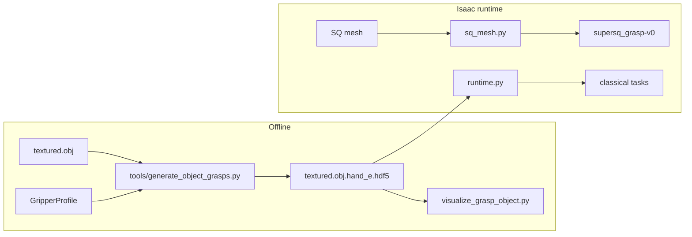

# Grasp Sampler

Offline antipodal grasp generation and online grasp loading for MetaSQGrasp. Used by classical tasks (`object-v0-Classical`) and online SQ mesh sampling (`supersq_grasp-v0`).

---

## Overview



**Offline:** sample grasps on object mesh → store in HDF5.  
**Online:** load candidates, filter against live scene, retarget to `hande_end`, execute pick-lift state machine.

---

## Key modules

| File | Role |
|------|------|
| `gripper_profile_defaults.py` | Hand-E / 2F85 width limits and HDF5 suffix (**single config entry point**) |
| `gripper_profiles.py` | Profile definitions and EE frame conversion |
| `database_paths.py` | `UR_grasp_database/` path resolution, `DEMO_OBJ_IDS` |
| `runtime.py` | Load HDF5, collision filter, rank grasps at runtime |
| `sq_mesh.py` | Online antipodal sampling on estimated SQ mesh |
| `visualize_grasp_object.py` | Offline grasp visualization |

---

## Gripper profiles

Edit [`gripper_profile_defaults.py`](gripper_profile_defaults.py):

| Constant | Default | Meaning |
|----------|---------|---------|
| `HAND_E_WIDTH_MAX_CM` | 7.0 | Max jaw span for Hand-E sampling and filtering |
| `HAND_E_HDF5_SUFFIX` | `.hand_e` | Output HDF5 filename suffix |
| `HAND_E_PREGRASP_EXTRA_CM` | 1.0 | Pre-grasp clearance |

Hand-E HDF5 output: `textured.obj.hand_e.hdf5`  
2F85 HDF5 output: `textured.obj.2f85.hdf5`

---

## Generate grasps (offline)

From the MetaSQGrasp root (`metagrasp/MetaSQGrasp/`):

```bash
conda activate metagrasp

python tools/generate_object_grasps.py \
  --mesh_root UR_grasp_database \
  --categories 000 001 004 011 \
  --gripper_profile hand_e \
  --num_points 500 \
  --max_grasps 2000 \
  --pool_size 1
```

Visualize:

```bash
python grasp_sampler/visualize_grasp_object.py \
  --mesh_root UR_grasp_database \
  --categories 001 \
  --gripper_profile hand_e \
  --max_grasps 50 \
  --frame ee
```

Use `--frame sampler` to view the raw sampler frame instead of the execution-equivalent `hande_end` frame.

---

## Coordinate frames

| Frame | Units | Used for |
|-------|-------|----------|
| Object-local (HDF5) | cm | Offline grasp database rows |
| Sampler gripper | cm | `convert_to_gripper_6d()` output (+X jaw, +Z approach) |
| Robot base | m | Live object pose, IK |
| `hande_end` | m | Differential IK target, state machine |

Retargeting pipeline: HDF5 row → sampler gripper pose → object pose in robot base → axis remap to `hande_end`.

A wrong axis mapping causes ~90° execution errors even when offline visualization looks correct.

---

## Runtime loading (classical)

```python
from grasp_sampler.runtime import resolve_mesh_root, select_best_grasp

mesh_root = resolve_mesh_root()
grasp = select_best_grasp(
    object_id="001",
    gripper_profile="hand_e",
    object_pose_robot=obj_pose_4x4,
    scene_collision_checker=checker,
)
```

---

## Documentation

| Doc | Description |
|-----|-------------|
| [`README.md`](README.md) | This quick start |
| [`sampling.md`](sampling.md) | Offline generation and runtime overview |
| [`pose-logistics.md`](pose-logistics.md) | Coordinate frames, collision filtering, retry |
| [`retargeting.md`](retargeting.md) | Sampler → `hande_end` retargeting |

Related: [`UR_grasp_database/README.md`](../UR_grasp_database/README.md), [`tools/README.md`](../tools/README.md)
