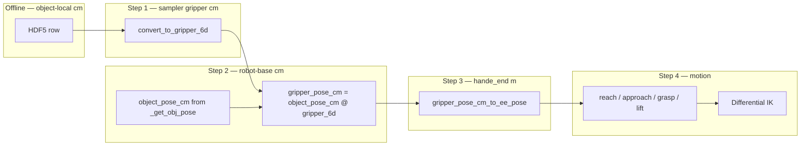

# Grasp Retargeting (Sampler → Robot Command Frame)

This document explains **how offline antipodal grasps are retargeted** from the hardware-agnostic sampler representation to the UR10e + Hand-E `hande_end` command frame used by Isaac Sim IK and the classical pick state machine.

For the full classical task workflow (HDF5 generation, collision filtering, spawn policy), see:

- [pose-logistics.md](./pose-logistics.md)
- [../UR_grasp_database/workflow.md](../UR_grasp_database/workflow.md)

---

## What “retargeting” means here

The antipodal sampler stores grasps in a **gripper-agnostic contact format** inside HDF5. Those rows are **not** robot poses. Retargeting is the process of:

1. Building a 4×4 gripper pose from contact data (`vec_a`, `vec_b`, `contact_pt`, `width`).
2. Composing that pose with the **live object link pose** in robot base frame.
3. Remapping the sampler gripper axes to the **Isaac command frame** (`hande_end`).
4. Sending the result to differential IK and the reach → approach → grasp state machine.

If step 3 uses the wrong axis mapping, offline visualization can look correct while execution is rotated by ~90°.

---

## Coordinate frames

| Frame | Units | Axes (local) | Used for |
|-------|-------|--------------|----------|
| **Object-local (HDF5)** | cm | Stored `vec_a`, `vec_b`, `contact_pt` | Offline grasp database |
| **Sampler gripper** | cm | **+X** = jaw baseline, **+Z** = approach | `convert_to_gripper_6d()` output |
| **Robot base** | m, quat wxyz | World-aligned table / object pose | `_get_obj_pose()`, `_get_ee_pose()`, IK |
| **`hande_end` (EE command)** | m, quat wxyz | **+X** = jaw opening, **+Y** = palm→fingertip approach | Differential IK target, state machine |

All runtime grasp math uses **one consistent parent frame: robot base** (`ur10e_hand_e/base_link`).

### HDF5 row layout

Each row in `grasps/paralleljaw/pregrasp_transform`:

| Index | Field | Sampler meaning |
|-------|-------|-----------------|
| 0–2 | `vec_a` | Approach direction (becomes sampler local **+Z**) |
| 3–5 | `vec_b` | Jaw baseline / opening axis (becomes sampler local **+X**) |
| 6–8 | `contact_pt` | First antipodal contact (object-local, cm) |
| 9 | `width` | Jaw opening (cm) |

---

## Retargeting pipeline



---

## Step-by-step transformation

### Step 1 — Contact row → sampler 4×4 (cm)

**File:** `grasp_sampler/gripper_profiles.py` → `ParallelJawProfile.convert_to_gripper_6d()`

```python
# Rotation columns: [baseline, cross(approach, baseline), approach]
rotation = [vec_b, cross(vec_a, vec_b), vec_a].T

# Translation: jaw midpoint, offset back along approach by contact_to_ee_offset_cm
midpoint = contact_pt + (width / 2) * vec_b
translation = midpoint - contact_to_ee_offset_cm * vec_a
```

For Hand-E, `contact_to_ee_offset_cm = 0.0` because `hande_end` is the fingertip command frame.

### Step 2 — Compose with live object pose

**File:** `grasp_sampler/runtime.py` → `filter_grasps_for_pose()` / `select_best_grasp()`

```python
object_pose_cm = pose_vector_to_matrix_cm(_get_obj_pose())  # m → cm for translation
gripper_pose_cm = object_pose_cm @ convert_to_gripper_6d(vec_a, vec_b, contact_pt, width)
```

**Important:** `_get_obj_pose()` returns the **object link frame** (mesh origin), not center-of-mass, because HDF5 grasps are defined on the mesh link.

### Step 3 — Sampler gripper → `hande_end` 7D pose

**File:** `grasp_sampler/gripper_profiles.py` → `HandEProfile.gripper_pose_cm_to_ee_pose()`

The sampler stores baseline on local **+X** and approach on local **+Z**. The **loaded Isaac USD** exposes:

| Sampler axis | Maps to `hande_end` local |
|--------------|---------------------------|
| baseline (+X) | **+X** (jaw opening) |
| approach (+Z) | **+Y** (palm → fingertips) |
| side (+Y) | **+Z** |

```python
baseline = normalize(gripper_pose_cm[:3, 0])
approach = normalize(gripper_pose_cm[:3, 2])
side = normalize(cross(baseline, approach))
rotation = stack([baseline, approach, side], axis=1)  # EE columns
translation_m = gripper_pose_cm[:3, 3] / 100.0
pose = [x, y, z, qw, qx, qy, qz]  # robot base, meters
```

**Do not assume the URDF text matches the loaded USD.** The shipped Hand-E URDF describes one convention; Isaac Sim loads a USD whose effective `hande_end` axes were verified empirically (see [Verification](#verification-checklist) below).

### Step 4 — State machine uses the EE pose

**File:** `isaac_env/object_env_classical/wp_cfg.py`

| State | EE target | Retargeting note |
|-------|-----------|------------------|
| `reach` | Pre-grasp pose | Retreat `APPROACH_DISTANCE` along **EE local +Y** (approach axis) |
| `approach` | Interpolated pre-grasp → grasp | Same rotation; position alpha-blends over `CLASSICAL_APPROACH_DURATION` |
| `grasp` | Full `grasp_pose` | Hold pose, close gripper |
| `lift` | `grasp_pose` + `LIFT_HEIGHT` in world Z | Vertical lift |

Pre-grasp retreat must use the **same EE axis as the approach direction** after retargeting:

```python
retreat = quat_rotate(grasp_rot, vec3(0.0, APPROACH_DISTANCE, 0.0))
pregrasp_pos = grasp_pos - retreat
```

---

## Why visualization and execution can disagree

| Symptom | Typical cause |
|---------|----------------|
| Grasp looks right offline, robot rotates ~90° | Wrong column remap in `gripper_pose_cm_to_ee_pose()` |
| Pre-grasp collides with object/table | Retreat axis wrong (e.g. EE +Z instead of +Y) |
| Robot reaches far from object | Object pose frame mismatch (world vs robot base) |
| Side grasp despite “prefer top-down” | Old soft ranking only; use `CLASSICAL_MIN_TOPDOWN_ALIGNMENT` |

**Rule of thumb:** Compare `--frame ee` offline visualization against Isaac execution. They should match when retargeting is correct.

---

## Verification checklist

Run these in order when changing gripper assets, profiles, or state-machine retreat logic.

### 1. Synthetic frame unit test (no Isaac)

```bash
conda activate metagrasp
cd metagrasp/MetaSQGrasp

python tools/check_hande_frame.py
```

Expected:

```text
[OK] Hand-E frame check passed: baseline->EE+X, approach->EE+Y.
```

This validates `HandEProfile.gripper_pose_cm_to_ee_pose()` and the pre-grasp retreat axis on synthetic data.

### 2. Real HDF5 grasp + classical spawn pose (no Isaac)

```bash
python tools/verify_classical_grasp_frame.py
```

Checks axis alignment for a collision-free grasp on object `001` at the classical spawn pose. Look for:

```text
[OK] Grasp command frame matches loaded Isaac USD convention (baseline->+X, approach->+Y).
approach_robot=[..., ..., ...] topdown_alignment=0.75+
```

### 3. Inspect one HDF5 row (optional, debug)

```bash
python tools/calibrate_hande_grasp_frame.py --object 001 --grasp_idx 0
```

Prints candidate rotation remaps and the active profile output side-by-side.

### 4. Offline visualization (execution-equivalent frame)

```bash
python grasp_sampler/visualize_grasp_object.py \
  --root UR_grasp_database \
  --dataset_name . \
  --object 001 \
  --frame ee \
  --max_grasps 50
```

- `--frame ee` — gripper mesh drawn in the **executed** `hande_end` convention (+X jaw, fingers along −Y).
- `--frame sampler` — raw sampler frame (+X baseline, +Z approach).

### 5. Ground-truth measurement in Isaac Sim

When URDF text and code disagree, measure the loaded asset:

```bash
conda activate metagrasp

PYTHONUNBUFFERED=1 python tools/measure_hande_end_frame.py \
  --enable_cameras --headless 2>&1 | rg "dot_finger|dot_finger_mid|measured"
```

Interpretation:

- `dot_finger ≈ +1` on **ee_x** → jaw opening is EE +X.
- `dot_finger_mid_to_end ≈ +1` on **ee_y** → approach (palm→fingertip) is EE +Y.

Update `HandEProfile.gripper_pose_cm_to_ee_pose()` and `wp_cfg.py` retreat axis to match these measurements.

### 6. End-to-end smoke test

```bash
python run.py --task object-v0-Classical --obj_ids 001 \
  --num_envs 1 --headless --enable_cameras
```

Watch the runtime log:

```text
[Classical Grasp] ... align=0.92 approach_robot=[..., ..., -0.9+] ...
```

`approach_robot` is the sampler approach axis in robot base frame. For top-down grasps it should point roughly toward `(0, 0, -1)`.

---

## Tuning parameters (classical task)

Edit `isaac_env/object_env_classical/element_cfg.py`:

| Parameter | Default | Retargeting / motion role |
|-----------|---------|---------------------------|
| `CLASSICAL_MIN_TOPDOWN_ALIGNMENT` | `0.75` | Hard-filter: only top-down candidates when available |
| `CLASSICAL_TOPDOWN_AXIS` | `(0, 0, -1)` | Robot-base “down” for alignment scoring |
| `APPROACH_DISTANCE` | `0.08` m | Pre-grasp retreat along EE +Y |
| `CLASSICAL_PREGRASP_HOLD_TIME` | `0.25` s | Pause at pre-grasp |
| `CLASSICAL_APPROACH_DURATION` | `1.25` s | Interpolate pre-grasp → grasp |
| `CLASSICAL_APPROACH_TIMEOUT` | `2.0` s | Force transition to close if IK is slow |

---

## Adapting retargeting for a new gripper

1. **Add a profile** in `grasp_sampler/gripper_profiles.py`:
   - `width_max_cm`, `pregrasp_extra_cm`, `contact_to_ee_offset_cm`
   - Override `gripper_pose_cm_to_ee_pose()` with the correct column remap
   - Override `build_collision_manager()` for scene filtering

2. **Regenerate HDF5** with the matching profile:

   ```bash
   python tools/generate_object_grasps.py \
     --mesh_root UR_grasp_database \
     --categories 001 \
     --gripper_profile hand_e
   ```

   Width and suffix default from `grasp_sampler/gripper_profile_defaults.py`.

3. **Measure the loaded Isaac EE frame** (Step 5 above) — do not trust URDF labels alone.

4. **Update state-machine retreat** in the task’s `wp_cfg.py` to back off along the measured approach axis.

5. **Add a frame check script** patterned on `tools/check_hande_frame.py`.

6. **Validate** with `--frame ee` visualization and a short Isaac run.

### Legacy Franka profile

`ParallelJawProfile.gripper_pose_cm_to_ee_pose()` (base class) uses a different remap:

```python
rotation = stack([baseline, approach, cross(baseline, approach)], axis=1)
```

Legacy Franka tasks retreat along EE **+Y** in their own `wp_cfg.py`. Do not mix Franka HDF5 (8 cm jaw) with Hand-E runtime (7 cm max from `HAND_E_WIDTH_MAX_CM`).

---

## Key source files

| File | Retargeting role |
|------|------------------|
| `grasp_sampler/gripper_profile_defaults.py` | Hand-E / 2F85 width and HDF5 suffix (edit once) |
| `grasp_sampler/gripper_profiles.py` | Contact → sampler 4×4; sampler → EE 7D; collision geometry |
| `grasp_sampler/runtime.py` | Object pose compose, collision filter, `select_best_grasp()` |
| `isaac_env/object_env_classical/env.py` | Runtime hook: selects grasp, logs `approach_robot` |
| `isaac_env/object_env_classical/wp_cfg.py` | Pre-grasp retreat / interpolated approach along EE +Y |
| `isaac_env/env_base/env.py` | `_get_obj_pose()`, `_get_ee_pose()` frame sources |
| `grasp_sampler/visualize_grasp_object.py` | Offline `--frame ee` vs `--frame sampler` |
| `tools/check_hande_frame.py` | Fast synthetic remap test |
| `tools/verify_classical_grasp_frame.py` | HDF5 + spawn pose alignment test |
| `tools/calibrate_hande_grasp_frame.py` | Per-grasp candidate remap table |
| `tools/measure_hande_end_frame.py` | Isaac ground-truth EE / finger axes |

---

## Troubleshooting

| Symptom | Check | Fix |
|---------|-------|-----|
| ~90° rotated gripper at execution | `check_hande_frame.py`, `measure_hande_end_frame.py` | Fix `HandEProfile.gripper_pose_cm_to_ee_pose()` column order |
| Pre-grasp hits object | Retreat direction in `wp_cfg.py` | Retreat along EE **+Y**, not +Z |
| Horizontal grasp selected | Log `approach_robot`, `align=` | Raise `CLASSICAL_MIN_TOPDOWN_ALIGNMENT` |
| Robot far from object | `verify_classical_grasp_frame.py` spawn pose | Ensure object pose is robot-base frame, not world + robot offset |
| Offline OK, Isaac wrong | Compare `--frame ee` vs sim | Re-run `measure_hande_end_frame.py` after USD/URDF changes |
| `valid_candidates=0` | HDF5 profile / width | Regenerate with `--gripper_profile hand_e`; confirm `textured.obj.hand_e.hdf5` exists |

---

## Quick reference — Hand-E axis mapping

```
Sampler frame          hande_end (loaded Isaac USD)
─────────────────      ───────────────────────────
local +X  baseline  →  local +X  (jaw opening)
local +Z  approach  →  local +Y  (palm → fingertips)
local +Y  side      →  local +Z

Pre-grasp retreat:  -EE +Y * APPROACH_DISTANCE
Top-down check:     dot(sampler_approach_in_robot_base, (0,0,-1))
```

This mapping is the result of empirical measurement on the loaded Hand-E USD used by `object-v0-Classical`, not an assumption from URDF documentation alone.
