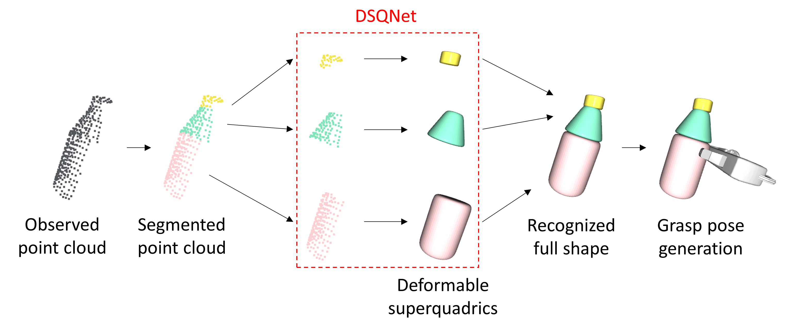

# Deformable Superquadric Network (DSQNet)
The official repository for &lt;DSQNet: A Deformable Model-Based Supervised Learning Algorithm for Grasping Unknown Occluded Objects> (Seungyeon Kim<sup>\*</sup>, Taegyun Ahn<sup>\*</sup>, Yonghyeon Lee, Jihwan Kim, Michael Yu Wang, and Frank C. Park, T-ASE 2022).

<sup>\*</sup> The two lead co-authors contributed equally.

> The paper proposes a recognition-based grasping method that merges a richer set of shape primitives, the deformable superquadrics, with a deep learning network, DSQNet, that is trained to identify complete object shapes from partial point cloud data.

- *[Project page](https://dsqnet.github.io/)*
- *[Paper](https://ieeexplore.ieee.org/abstract/document/9802912)* 
- *[Supplementary video](https://ieeexplore.ieee.org/abstract/document/9802912/media#media)* 

## Preview

<I>Figure 1: Pipeline for proposed recognition-based grasping algorithm: (i) a trained segmentation network is used to segment a partially observed point cloud into a set of simpler point clouds; (ii) The trained DSQNet converts each point cloud into a deformable superquadric primitive, with its collective union representing the full object shape; (iii) grasp poses are generated in a gripper-dependent manner from the recognized full shapes. </I>

## Requirements
### Environment
The project codes are tested in the following environment.
- python 3.8.13
- pytorch 1.12.0
- wandb
- pandas
- scikit-learn
- Open3D

### Datasets
Datasets should be stored in `datasets/` directory. Datasets can be downloaded through the [Google drive link](https://drive.google.com/drive/folders/1PQ9dSeD0WmdESQemsnM1SPmpPDChQ95s?usp=sharing). After set up, the `datasets/` directory should be as follows.
```
datasets
├── primitive_dataset
│   ├── box
│   ├── ... (4 more folders)
│   ├── truncated_torus
│   ├── train_datalist.csv
│   ├── validation_datalist.csv
│   └── test_datalist.csv
├── object_dataset
│   ├── bottle_cone
│   ├── ... (10 more folders)
│   ├── truncated_torus
│   ├── train_datalist.csv
│   ├── validation_datalist.csv
│   └── test_datalist.csv
└── evaluation_dataset
    ├── bottle_cone
    ├── ... (10 more folders)
    └── truncated_torus

```
- (Optional) If you want to generate your own custom dataset, see **[DATA_GENERATION.md](DATA_GENERATION.md)** for the full synthetic data engine (primitive, object, and extended superquadric modes, metadata, and training integration).

  Quick examples:
  ```
  python data_generation.py --config primitive --name primitive_dataset
  python data_generation.py --config object --name object_dataset
  python data_generation.py --config extended_sq --name extended_sq_dataset
  ```
- `X` is `primitive`, `object`, or `extended_sq`.
- `Y` is a folder name under `datasets/`.
> **Tips for playing with code:** You can create various objects by editing the json file in the folder `object_params`. You can also adjust the parameters of the dataset such as the number of the points of partially observed point cloud in the code `data_generation.py`.
> **Warning:** The data generation does not work in server (i.e., without a connected display). If you want generate a dataset in server, try [Open3D headless rendering](http://www.open3d.org/docs/latest/tutorial/Advanced/headless_rendering.html).

### Pretrained model
Pre-trained models should be stored in `pretrained/`. The pre-trained models are provided through the [Google drive link](https://drive.google.com/drive/folders/1PN7DF0iNL60iOuyA-QS2g7jMzXSOPD6a?usp=sharing). After set up, the `pretrained/` directory should be follows.
```
pretrained
├── segnet_config
│   └── example
│       ├── segnet_config.yml
│       └── model_best.pkl
├── sqnet_config
│   └── example
│       ├── sqnet_config.yml
│       └── model_best.pkl
└── dsqnet_config
    └── example
        ├── dsqnet_config.yml
        └── model_best.pkl
```

## Running
### Training
The training script is `train.py`. 
- `--config` specifies a path to a configuration yml file.
- `--logdir` specifies a directory where the results will be saved.
- `--run` specifies a name for an experiment.
- `--device` specifies an GPU number to use.
- `--wandb-project` specifies the W&B project name (default: `rgbsq_grasp`).
- `--wandb-entity` optionally specifies the W&B entity/team.
- `--wandb-tags` optionally specifies comma-separated W&B tags.

Training DSQNet (or SQNet) and segmentation network:
```
python train.py --config configs/{X}_config.yml
```
- `X` is either `sqnet`, `dsqnet` or `segnet`.
- Training metrics and 3D visualizations are logged to [Weights & Biases](https://wandb.ai). Log in once with `wandb login`, then open your run on the W&B dashboard.
- For headless/offline use: `WANDB_MODE=offline python train.py --config configs/{X}_config.yml`
- Checkpoints and config copies are still saved under `train_results/{X}_config/{run}/`.

### SQNet quick visualization
For inspecting a trained SQNet checkpoint on one partial point cloud (no SegNet required), use `supersq_inference.py`:

```
python supersq_inference.py \
  --object box \
  --index 0 \
  --device 0 \
  --config train_results/sqnet_config/{run}/sqnet_config.yml \
  --checkpoint train_results/sqnet_config/{run}/model_best.pkl \
  --visualize
```

- `--object` and `--index` load a sample from `datasets/evaluation_dataset/` (same object names as evaluation below).
- `--config` and `--checkpoint` point to your trained run under `train_results/`, or omit both to use `pretrained/sqnet_config/example/`.
- `--visualize` opens one Open3D window: partial point cloud + fitted superquadric mesh.
- See `IMPLEMENTATION.md` for more examples (`--input`, `--output`, `--viewpoint`, `--segment-id`).

### Evaluation
The evaluation script is `evaluation.py`. 
- `--object` specifies an object class to evaluate in object dataset.
- `--index` specifies an object index in 10 different objects with different shape parameters.
- `--run` specifies a name for an experiment.
- `--device` specifies an GPU number to use.
- `--iou` specifies an boolean action for whether to measure volumetric IoU or not (default: false).

Example evaluation code execution:
```
python evaluation.py --object {X} --index {Y}
```
- `X` is either `box`, `cylinder`, `cone`, `ellipsoid`, `truncated_cone`, `truncated_torus`, `hammer_cylinder`, `screw_driver`, `padlock`, `cup_with_lid`, `dumbbell`, or `bottle_cone`.
- `Y` is an integer between `0` and `9`.
- Evaluation opens Open3D viewer windows on your display (use `--no-visualize` on headless servers).
> **Warning:** The option `--iou` also does not work in server. If you want to measure IoU in server, try [Open3D headless rendering](http://www.open3d.org/docs/latest/tutorial/Advanced/headless_rendering.html).

### Grasp Pose Generation
The grasp pose generation script is `grasp_pose_generation.py`. 
- `--object` specifies an object class to evaluate in object dataset.
- `--index` specifies an object index in 10 different objects with different shape parameters.
- `--device` specifies an GPU number to use.

Example grasp pose generation code execution:
```
python grasp_pose_generation.py --object {X} --index {Y}
```
- `X` is either `box`, `cylinder`, `cone`, `ellipsoid`, `truncated_cone`, `truncated_torus`, `hammer_cylinder`, `screw_driver`, `padlock`, `cup_with_lid`, `dumbbell`, or `bottle_cone`.
- `Y` is an integer between `0` and `9`.
- One example grasp pose is visualized in the visualization window so the code should be excuted with display device (the code does not work in server). 

## Citation
```
@article{kim2022dsqnet,
  title={DSQNet: A Deformable Model-Based Supervised Learning Algorithm for Grasping Unknown Occluded Objects},
  author={Kim, Seungyeon and Ahn, Taegyun and Lee, Yonghyeon and Kim, Jihwan and Wang, Michael Yu and Park, Frank C},
  journal={IEEE Transactions on Automation Science and Engineering},
  year={2022},
  publisher={IEEE}
}
```


